# Data Visualization Library

A catalogue of **214 chart types** in Python. Each entry explains the chart's design purpose, when to use it and when to avoid it, and shows a worked example. Every chart ships as a **Jupyter notebook** (explanation and rendered output) and a **standalone Python script**.

**Browse visually:** open the [interactive gallery](https://maxyychen.github.io/visualisation/gallery/) (GitHub Pages): search, filter by goal, data and level, and open interactive charts live. github.com shows `.html` files as source code, so use that link, or open `gallery/index.html` from a local copy. On this page, the tables below show static previews and link to notebooks, which GitHub renders.

**Not sure which chart?** Read [How to Choose a Chart](HOW_TO_CHOOSE_A_CHART.md): a step-by-step guideline with a decision path, a finance quick reference and a pre-publication checklist.

**Using AI to make charts?** Read [Agentic AI and Data Visualization](AGENTIC_AI_AND_VISUALIZATION.md).

Families 01–09 follow the Financial Times [Visual Vocabulary](https://github.com/Financial-Times/chart-doctor/tree/main/visual-vocabulary), which groups charts by the *relationship in the data you want to show*. The other families are **Finance & investment**, **Healthcare & life sciences**, **Scientific**, **Machine learning**, **Uncertainty**, **Bad vs. good**, **Interactive, animated & big data**.

## Quick start

```bash
python3 -m venv .venv && source .venv/bin/activate
pip install -r requirements.txt
jupyter lab                                   # browse the notebooks
python 01_deviation/diverging_bar/diverging_bar.py
python 04_distribution/violin_plot/violin_plot.py --real-data   # charts marked ★ have real data
```

## How to choose a chart

1. **Decide what the reader should notice:** a difference from a baseline, a relationship, an order, a shape, a trend, a size, a share, a place, or a movement. That picks the family.
2. **Pick the simplest form in that family** that shows the message. If the story is one number, use a stat tile.
3. **Add color last**, and only by the job it does: identity (categorical), magnitude (one-hue sequential), or polarity (two-hue diverging with a neutral midpoint).
4. **Avoid the classic mistakes.** See [15 · Bad vs. good](#15-bad-vs-good).

**Chart chooser:** see [What data do you have?](#chooser) below, or filter by data type in the gallery.

Legend: 📄 method from a research paper (see [Methods from the research literature](#research)) · ★ real-dataset variant · 🔀 also shown in other libraries (plotly / Altair / seaborn) · <sub>intermediate</sub> / <sub>advanced</sub> level (unmarked = basic) · animated charts preview as GIFs

| Family | Charts | Question it answers |
|---|---|---|
| [Deviation](#01-deviation) | 6 | Emphasise variations (+/-) from a fixed reference point: zero, a target, or an average. |
| [Correlation](#02-correlation) | 14 | Show the relationship between two or more variables. |
| [Ranking](#03-ranking) | 8 | Use when an item's position in an ordered list matters more than its absolute value. |
| [Distribution](#04-distribution) | 12 | Show values in a dataset and how often they occur; the shape (skew, spread, gaps) is the story. |
| [Change over time](#05-change-over-time) | 17 | Emphasise changing trends, from intraday moves to series spanning decades. |
| [Magnitude](#06-magnitude) | 12 | Compare sizes, relative or absolute (usually counts rather than rates). |
| [Part-to-whole](#07-part-to-whole) | 12 | Show how a single entity breaks down into its components. |
| [Spatial](#08-spatial) | 10 | Use when precise locations or geographic patterns matter more than anything else. |
| [Flow](#09-flow) | 9 | Show the volume or intensity of movement between states, stages, or places. |
| [Finance & investment](#10-finance-investment) | 38 | Performance, risk, portfolios, markets, rates, derivatives and valuation, the everyday charts of investors and analysts. |
| [Healthcare & life sciences](#11-healthcare) | 19 | Clinical trials, survival, oncology, hospital quality and operations, epidemiology and patient-level records. |
| [Scientific](#12-scientific) | 11 | Domain-neutral statistics and research plots: effect sizes, meta-analysis, agreement, omics, replicates and visual inference. |
| [Machine learning](#13-machine-learning) | 14 | Evaluate and explain fitted models: classification performance, calibration, learning curves, residuals, feature importance and feature effects. |
| [Uncertainty](#14-uncertainty) | 7 | Show what is not known (intervals, probabilities and possible outcomes) so readers do not over-trust a single number. |
| [Bad vs. good](#15-bad-vs-good) | 10 | Common chart mistakes, each shown next to a better alternative that fixes it. |
| [Interactive, animated & big data](#16-interactive-advanced) | 15 | What-if sliders, linked views, animation and million-point rendering. Use these when exploration or motion adds understanding that a static chart cannot. |

<a id="01-deviation"></a>
## 01 · Deviation

*Emphasise variations (+/-) from a fixed reference point: zero, a target, or an average.*

| Chart | Use it to… | Files | Preview |
|---|---|---|---|
| **Diverging Bar Chart**  | Show how far each category sits above or below a baseline (zero, target, average) | [ipynb](01_deviation/diverging_bar/diverging_bar.ipynb) · [py](01_deviation/diverging_bar/diverging_bar.py) | 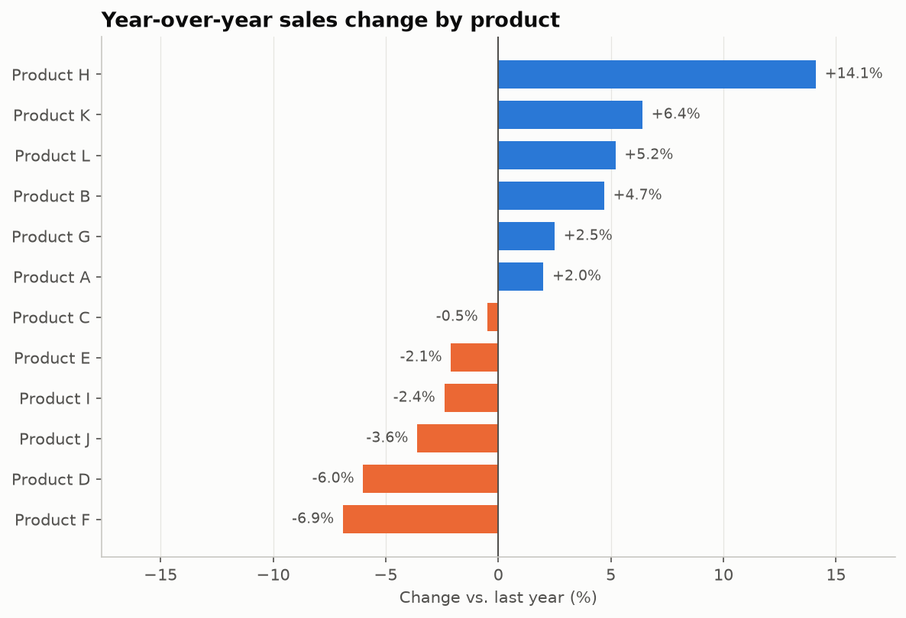 |
| **Diverging Stacked Bar (Likert)** <br><sub>intermediate</sub> | Show Likert-scale survey results (disagree ↔ agree) | [ipynb](01_deviation/diverging_stacked_bar/diverging_stacked_bar.ipynb) · [py](01_deviation/diverging_stacked_bar/diverging_stacked_bar.py) | 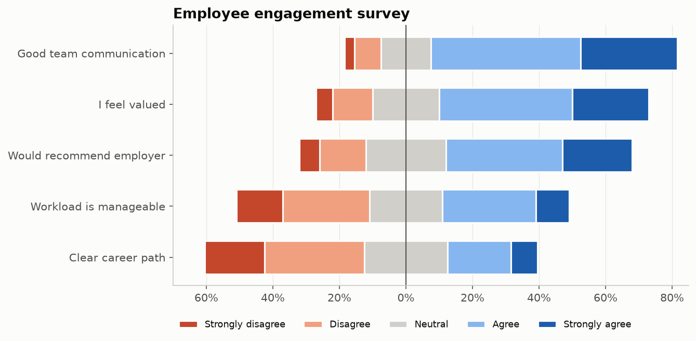 |
| **Surplus / Deficit Filled Line**  | Show a time series that swings around a baseline (balance, temperature anomaly, net flow) | [ipynb](01_deviation/surplus_deficit_line/surplus_deficit_line.ipynb) · [py](01_deviation/surplus_deficit_line/surplus_deficit_line.py) | 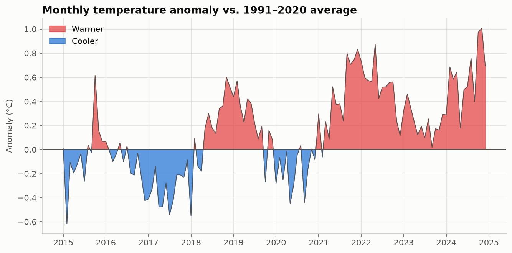 |
| **Deviation Lollipop (from mean)**  | Show how far each item sits from the average or target | [ipynb](01_deviation/deviation_lollipop/deviation_lollipop.ipynb) · [py](01_deviation/deviation_lollipop/deviation_lollipop.py) | 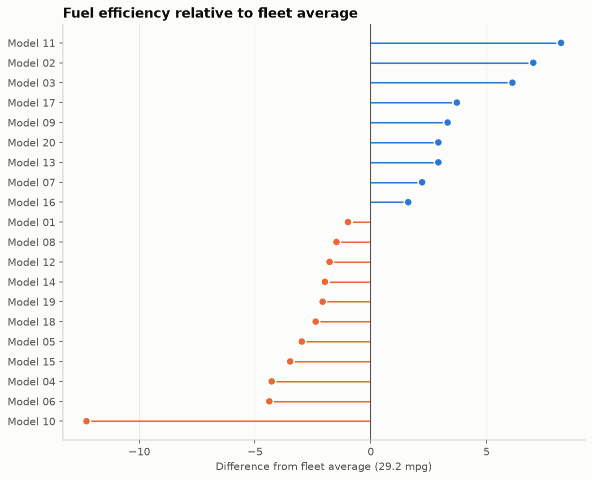 |
| **Diverging Column (over time)**  | Show discrete periods with signed results (monthly net cash flow, quarterly earnings surprise) | [ipynb](01_deviation/diverging_column_time/diverging_column_time.ipynb) · [py](01_deviation/diverging_column_time/diverging_column_time.py) | 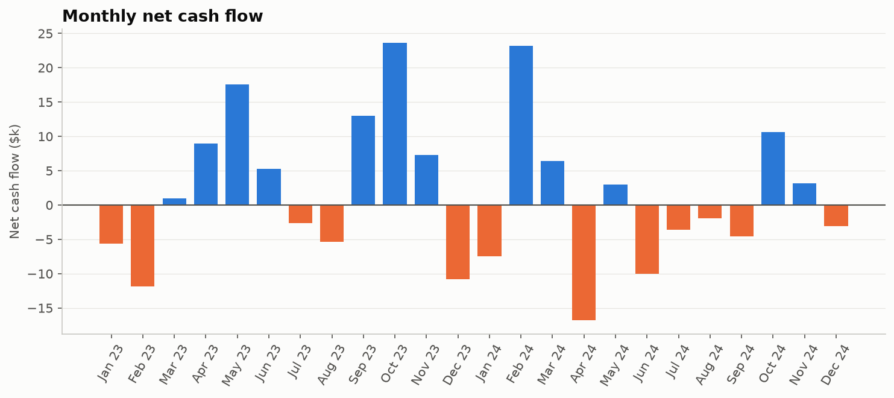 |
| **Spine Chart (opposing bars)**  | Show two opposing components per category (wins/losses, inflow/outflow, men/women) | [ipynb](01_deviation/spine_chart/spine_chart.ipynb) · [py](01_deviation/spine_chart/spine_chart.py) | 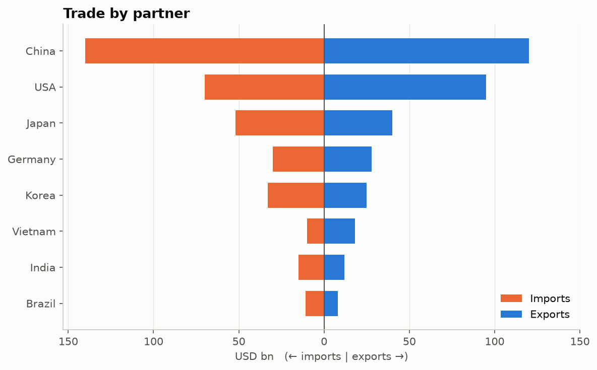 |

<a id="02-correlation"></a>
## 02 · Correlation

*Show the relationship between two or more variables.*

| Chart | Use it to… | Files | Preview |
|---|---|---|---|
| **Scatter Plot** ★🔀 | Show whether two numeric variables move together | [ipynb](02_correlation/scatter/scatter.ipynb) · [py](02_correlation/scatter/scatter.py) | 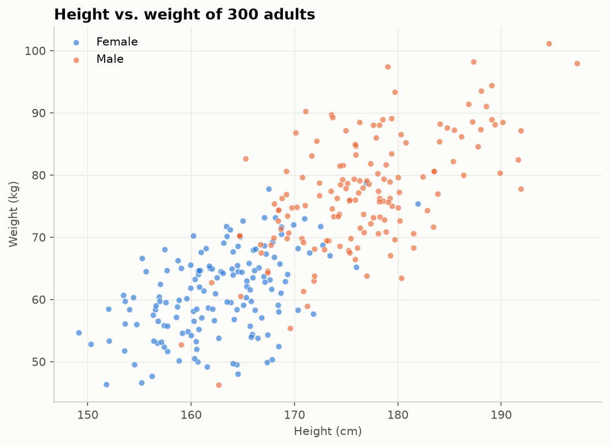 |
| **Scatter with Regression Line** ★🔀<br><sub>intermediate</sub> | Show the direction and strength of a roughly linear relationship | [ipynb](02_correlation/scatter_regression/scatter_regression.ipynb) · [py](02_correlation/scatter_regression/scatter_regression.py) | 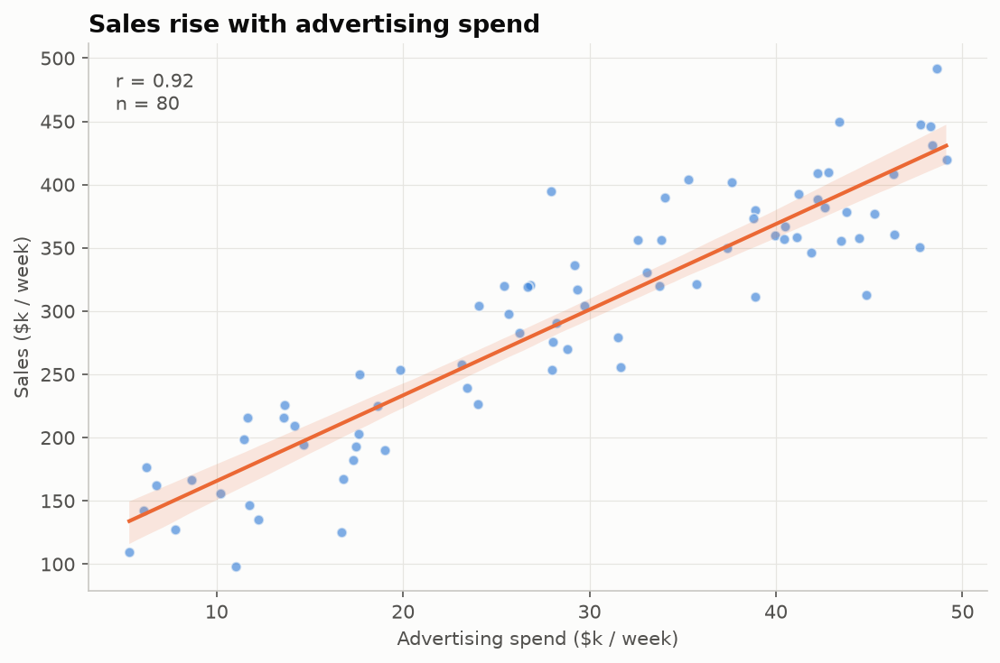 |
| **Bubble Chart** ★🔀 | Show three numeric variables at once (x, y, and size) | [ipynb](02_correlation/bubble/bubble.ipynb) · [py](02_correlation/bubble/bubble.py) | 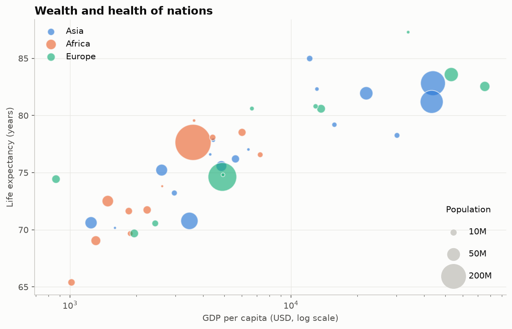 |
| **Connected Scatter Plot** <br><sub>intermediate</sub> | Show how two variables evolved together over time (e.g. unemployment vs. inflation) | [ipynb](02_correlation/connected_scatter/connected_scatter.ipynb) · [py](02_correlation/connected_scatter/connected_scatter.py) | 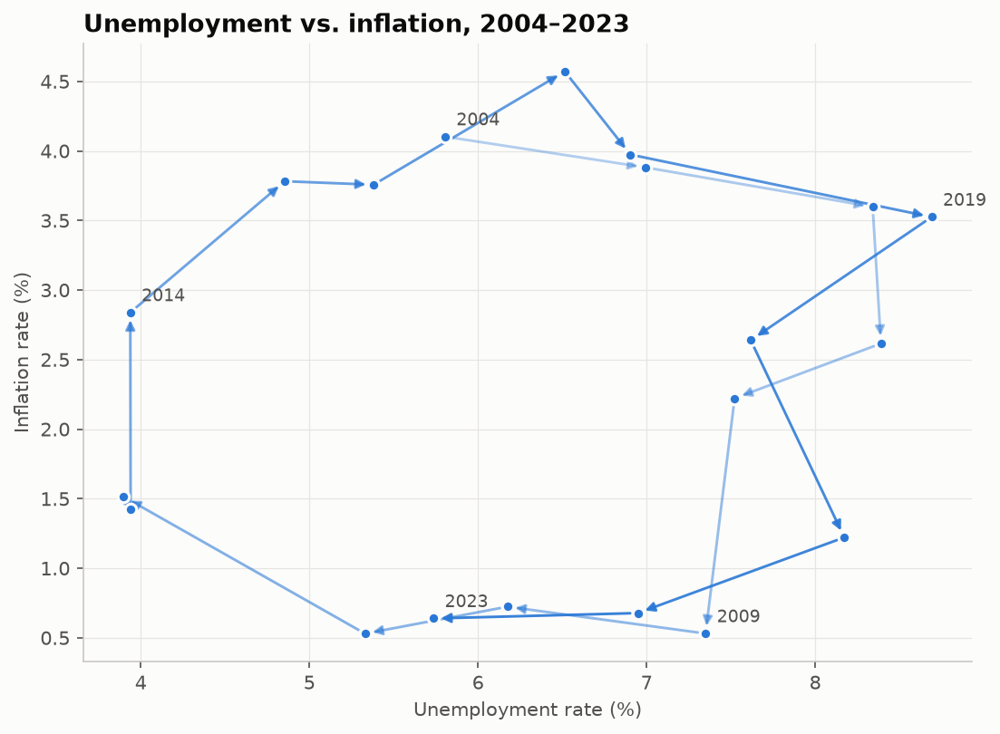 |
| **Correlation Matrix Heatmap** ★🔀<br><sub>intermediate</sub> | Screen many numeric variables for pairwise relationships | [ipynb](02_correlation/correlation_heatmap/correlation_heatmap.ipynb) · [py](02_correlation/correlation_heatmap/correlation_heatmap.py) | 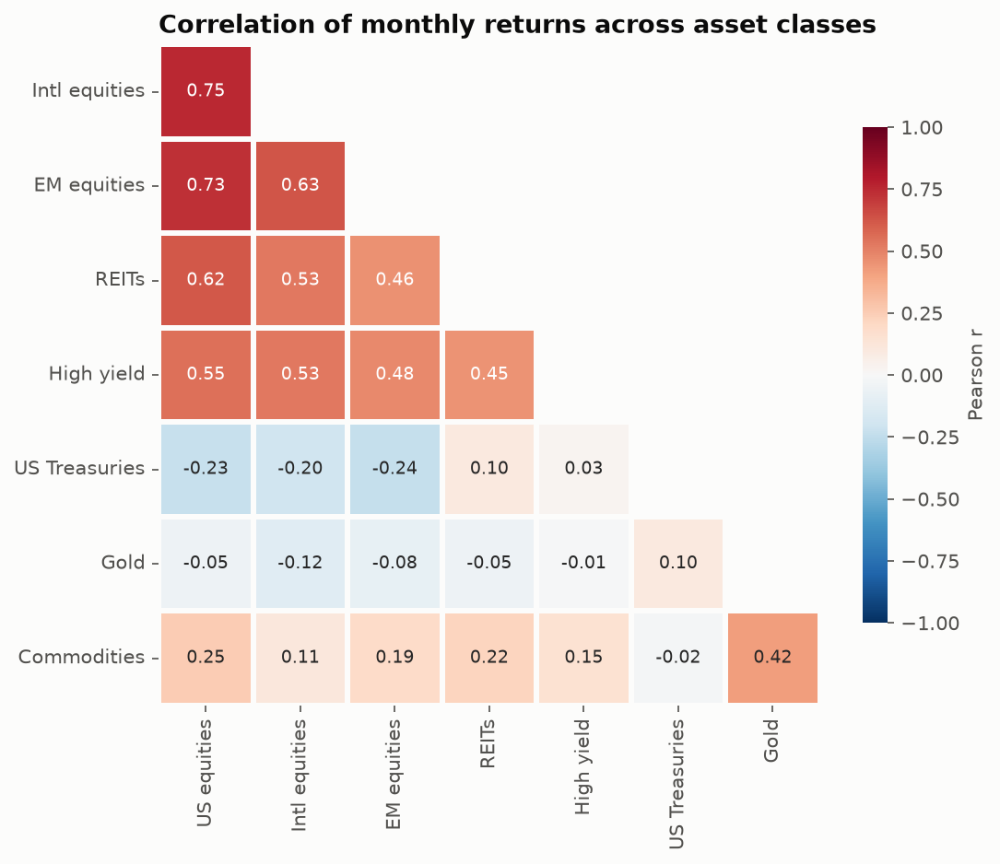 |
| **Hexbin Plot** <br><sub>intermediate</sub> | Show a two-variable relationship with thousands to millions of points | [ipynb](02_correlation/hexbin/hexbin.ipynb) · [py](02_correlation/hexbin/hexbin.py) | 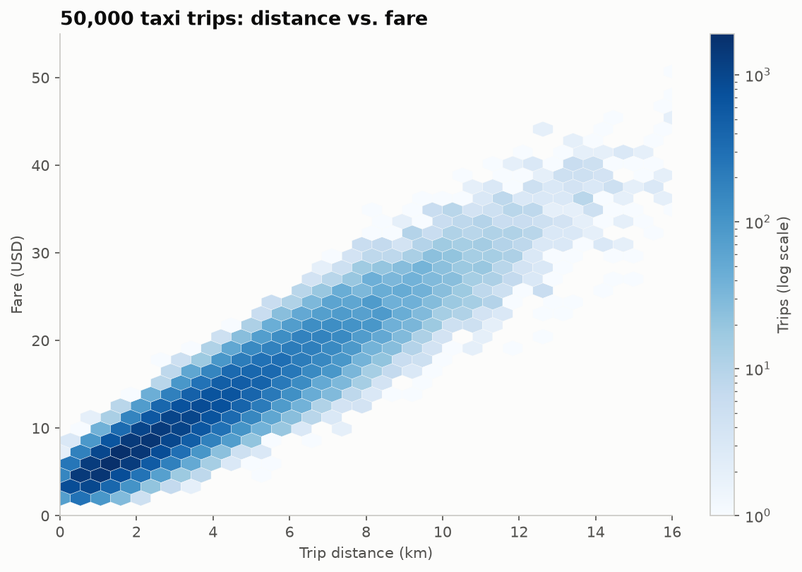 |
| **2-D Density Contour Plot** <br><sub>intermediate</sub> | Show where two variables jointly concentrate in large datasets | [ipynb](02_correlation/density_contour_2d/density_contour_2d.ipynb) · [py](02_correlation/density_contour_2d/density_contour_2d.py) | 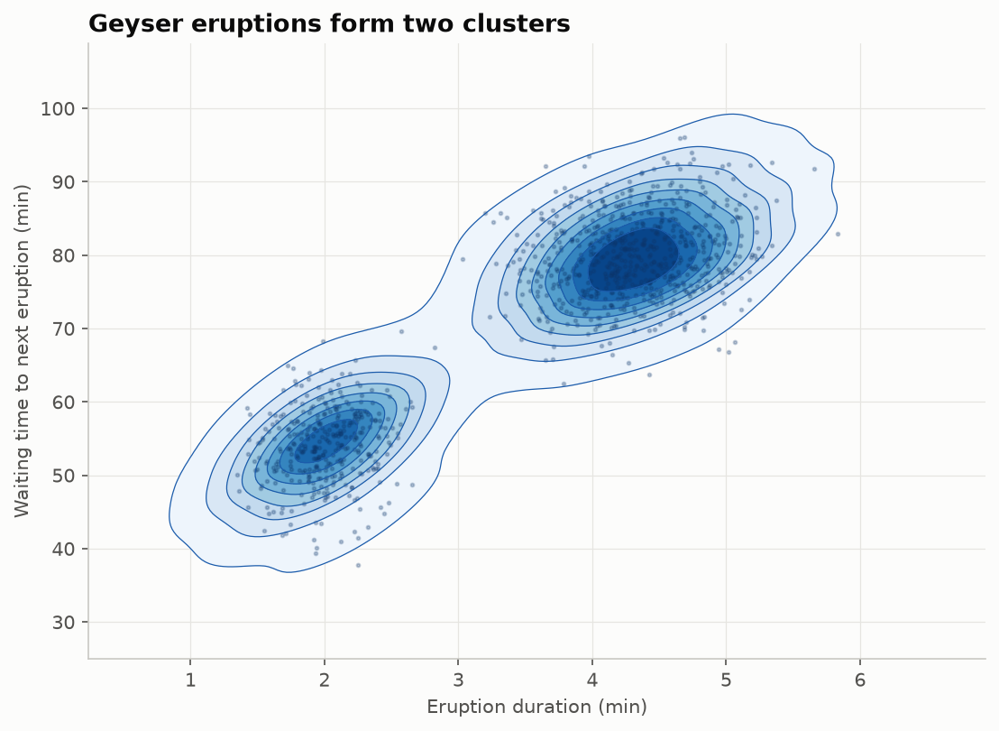 |
| **Pair Plot (Scatter-plot Matrix)** ★🔀<br><sub>intermediate</sub> | Explore relationships among 3–6 numeric variables at once | [ipynb](02_correlation/pair_plot/pair_plot.ipynb) · [py](02_correlation/pair_plot/pair_plot.py) | 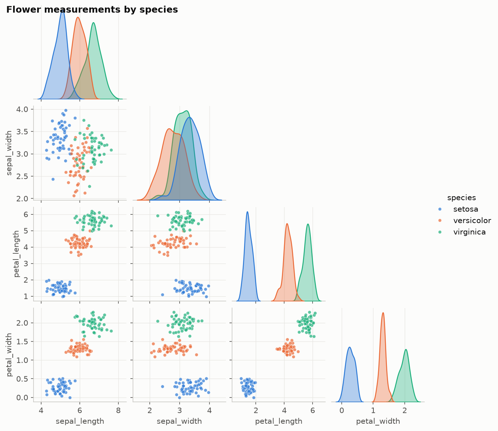 |
| **Joint Plot (Scatter + Marginals)** ★🔀<br><sub>intermediate</sub> | Show both the relationship and each variable's skew or outliers | [ipynb](02_correlation/joint_plot/joint_plot.ipynb) · [py](02_correlation/joint_plot/joint_plot.py) | 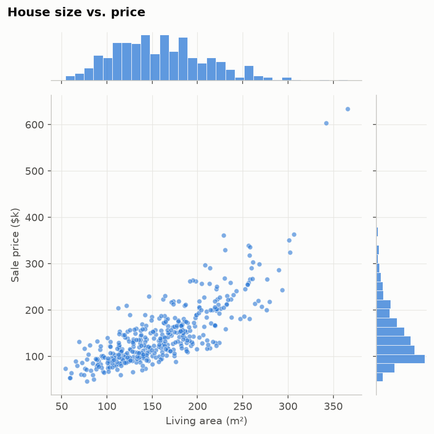 |
| **PCA Biplot** <br><sub>intermediate</sub> | Get an overview of a dataset with many numeric variables (5–50) | [ipynb](02_correlation/pca_biplot/pca_biplot.ipynb) · [py](02_correlation/pca_biplot/pca_biplot.py) | 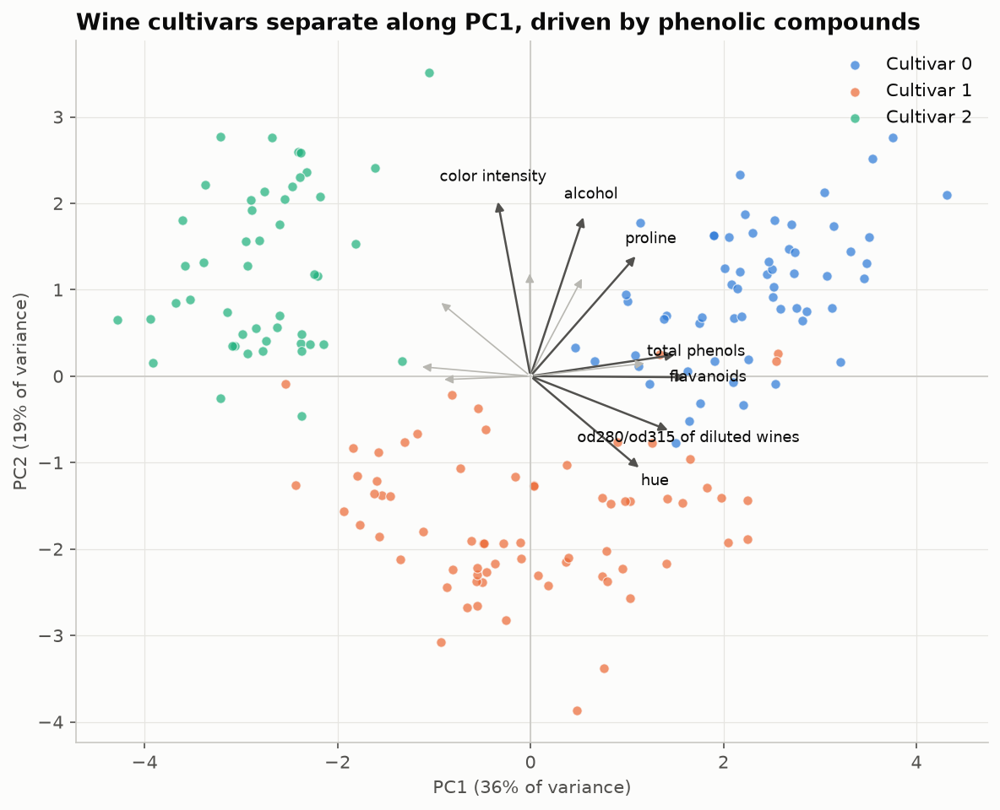 |
| **t-SNE / UMAP Embedding** <br><sub>advanced</sub> | Explore whether high-dimensional samples (patients, cells, documents) form clusters | [ipynb](02_correlation/tsne_embedding/tsne_embedding.ipynb) · [py](02_correlation/tsne_embedding/tsne_embedding.py) | 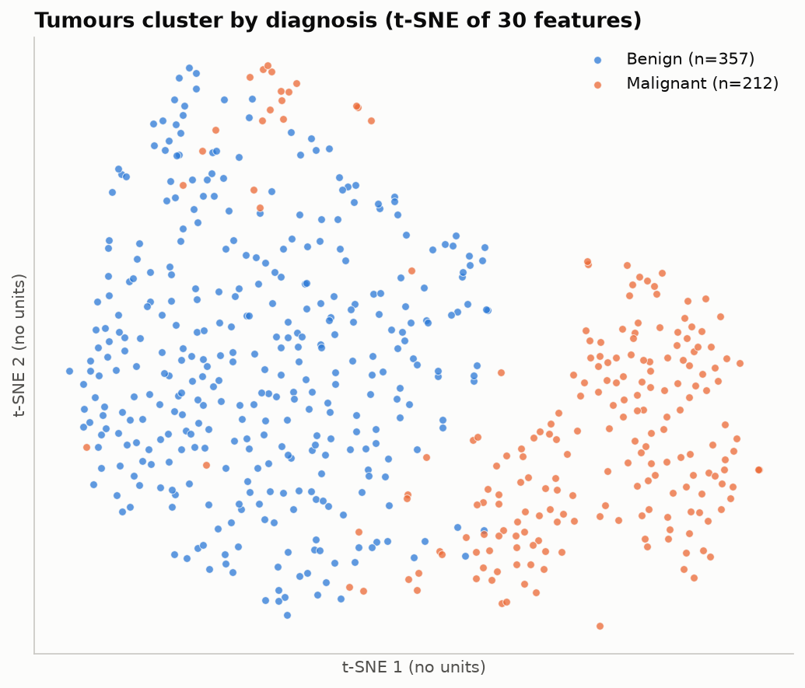 |
| **Dimension Reduction Comparison (t-SNE, UMAP, PaCMAP)** 📄<br><sub>advanced</sub> | Before trusting clusters or gaps in a single t-SNE or UMAP map | [ipynb](02_correlation/dimension_reduction_comparison/dimension_reduction_comparison.ipynb) · [py](02_correlation/dimension_reduction_comparison/dimension_reduction_comparison.py) | 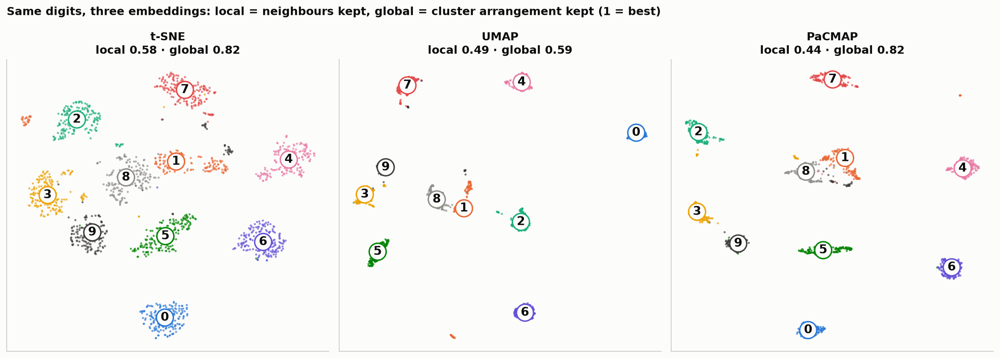 |
| **Projection Distortion Map (indicatrix)** 📄<br><sub>advanced</sub> | Before reading cluster size, spread or gaps from a t-SNE or UMAP map | [ipynb](02_correlation/projection_distortion/projection_distortion.ipynb) · [py](02_correlation/projection_distortion/projection_distortion.py) | 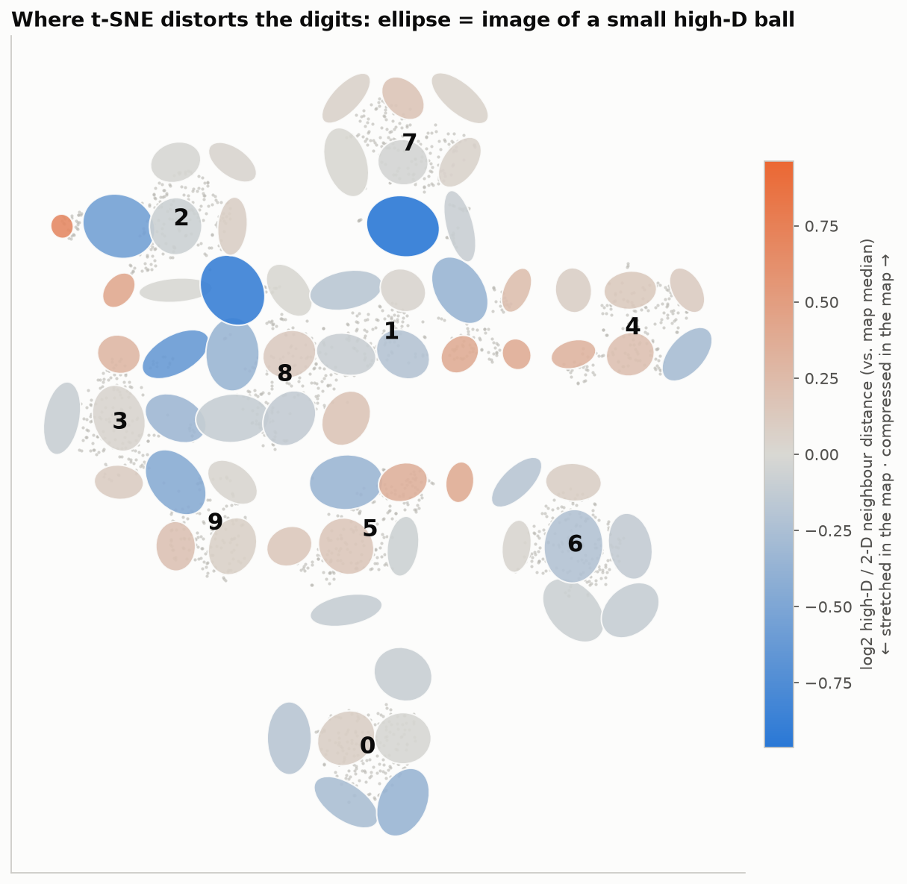 |
| **Scagnostics (scatterplot diagnostics)** 📄<br><sub>advanced</sub> | Screen many numeric variables (stock characteristics, risk factors, KPIs) for unusual pairwise patterns | [ipynb](02_correlation/scagnostics/scagnostics.ipynb) · [py](02_correlation/scagnostics/scagnostics.py) | 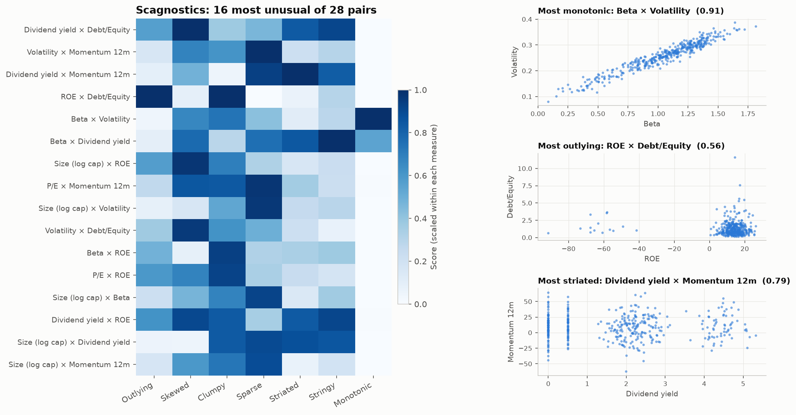 |

<a id="03-ranking"></a>
## 03 · Ranking

*Use when an item's position in an ordered list matters more than its absolute value.*

| Chart | Use it to… | Files | Preview |
|---|---|---|---|
| **Ordered Horizontal Bar Chart**  | Rank categories by a single value (top 10 products, countries, causes) | [ipynb](03_ranking/ordered_bar/ordered_bar.ipynb) · [py](03_ranking/ordered_bar/ordered_bar.py) | 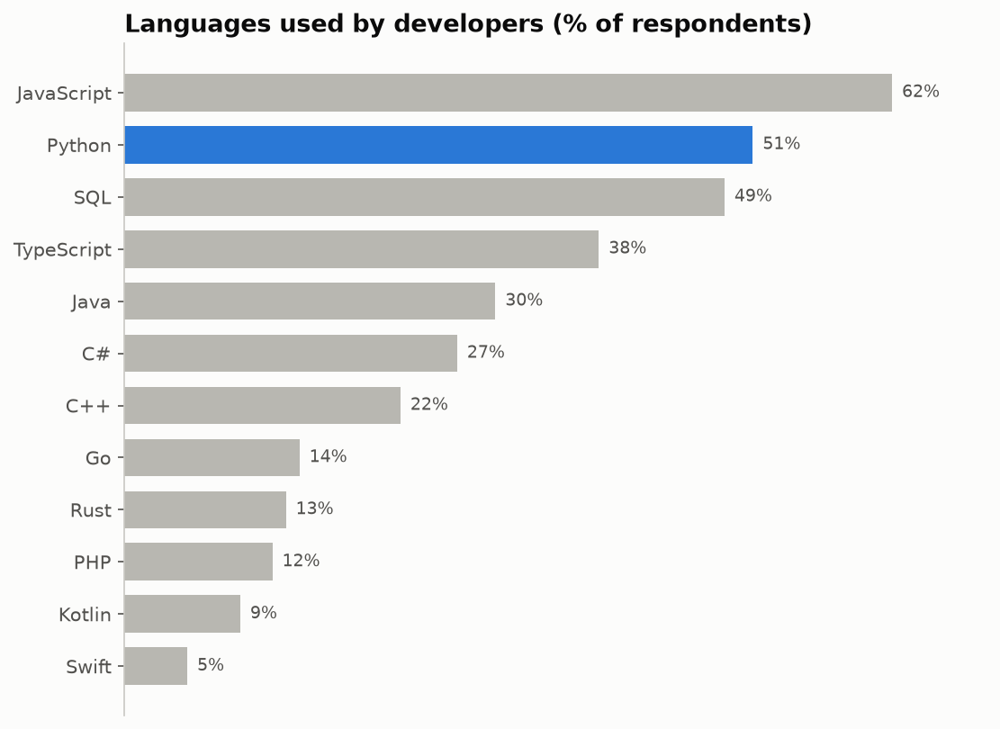 |
| **Ordered Column Chart**  | Rank a handful of categories with short names | [ipynb](03_ranking/ordered_column/ordered_column.ipynb) · [py](03_ranking/ordered_column/ordered_column.py) | 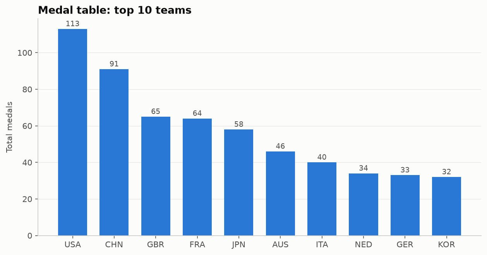 |
| **Lollipop Chart**  | Show rankings with many items (15–40) where bars would form a heavy block | [ipynb](03_ranking/lollipop_ranking/lollipop_ranking.ipynb) · [py](03_ranking/lollipop_ranking/lollipop_ranking.py) | 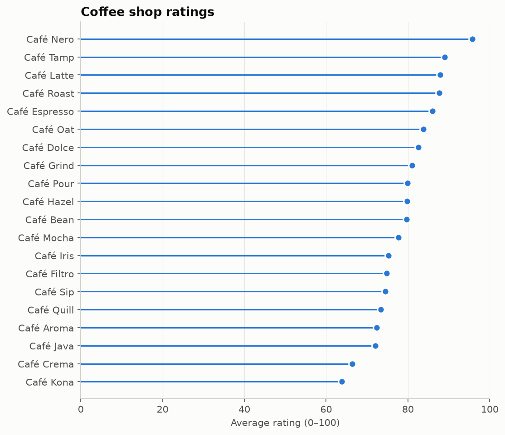 |
| **Cleveland Dot Plot**  | Rank values that are close together and far from zero (e.g. life expectancy 70–85) | [ipynb](03_ranking/cleveland_dot/cleveland_dot.ipynb) · [py](03_ranking/cleveland_dot/cleveland_dot.py) | 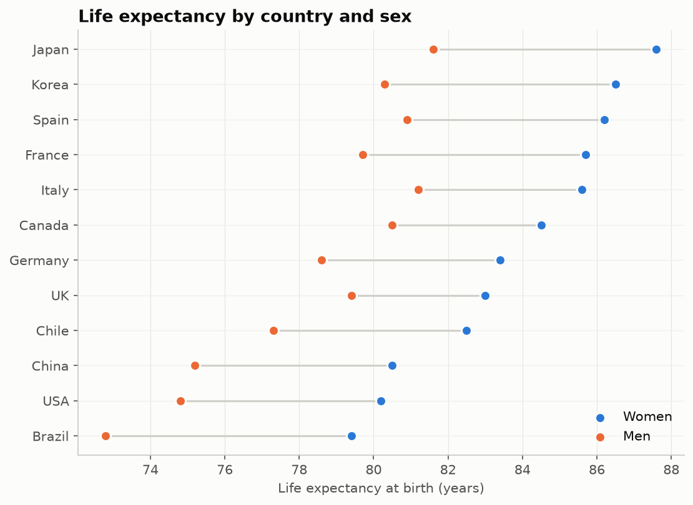 |
| **Dot Strip Plot (rank position)** <br><sub>intermediate</sub> | Show where one item (your city, your product) ranks across several metrics | [ipynb](03_ranking/dot_strip_plot/dot_strip_plot.ipynb) · [py](03_ranking/dot_strip_plot/dot_strip_plot.py) | 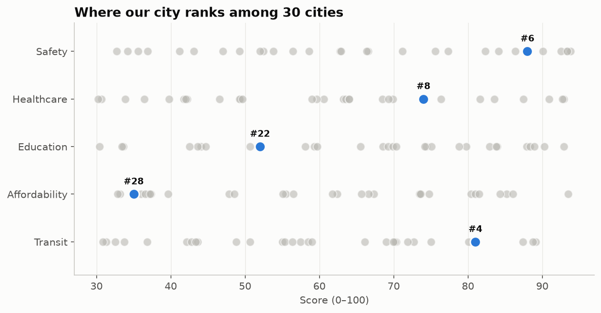 |
| **Slope Chart** ★🔀 | Compare rankings or values between exactly two time points or conditions | [ipynb](03_ranking/slope_chart/slope_chart.ipynb) · [py](03_ranking/slope_chart/slope_chart.py) | 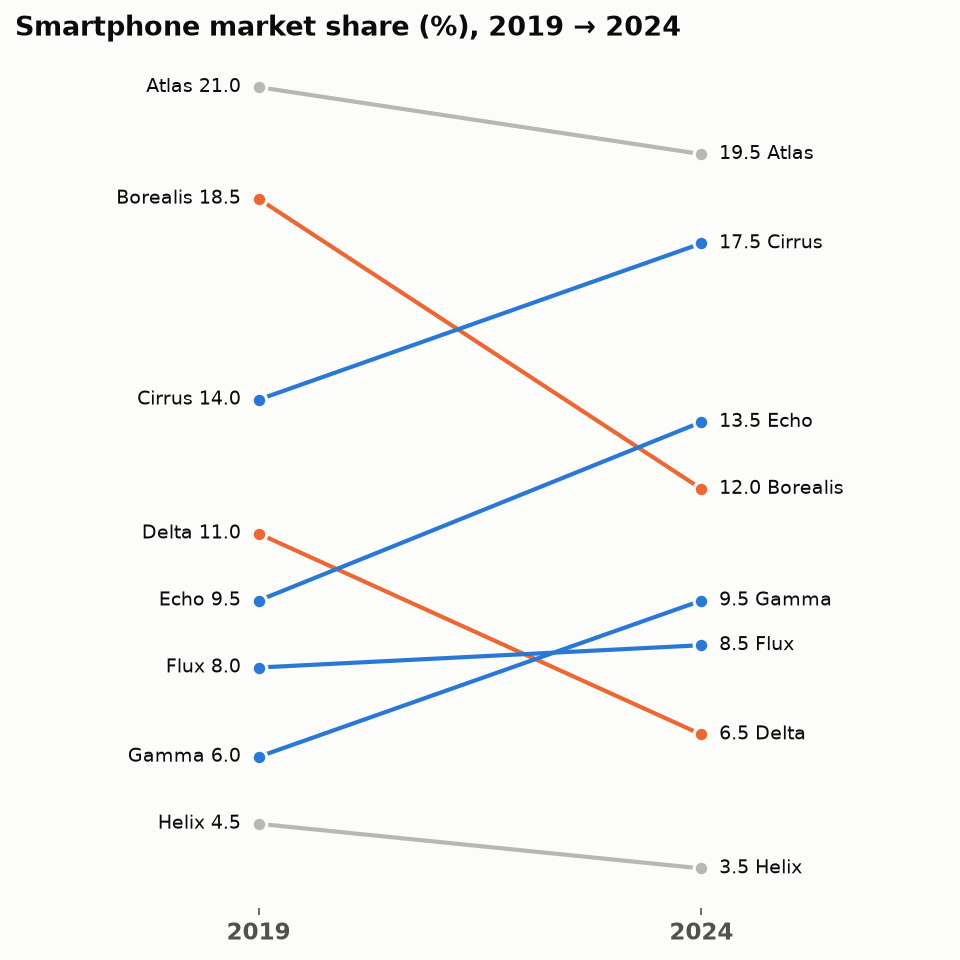 |
| **Bump Chart** <br><sub>intermediate</sub> | Track rank changes over several periods (league tables, top-10 charts) | [ipynb](03_ranking/bump_chart/bump_chart.ipynb) · [py](03_ranking/bump_chart/bump_chart.py) | 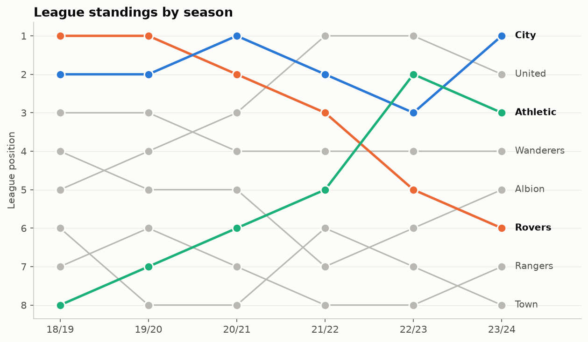 |
| **Ordered Proportional Symbol Chart**  | Rank items whose values differ by orders of magnitude (company valuations, city populations) | [ipynb](03_ranking/ordered_proportional_symbol/ordered_proportional_symbol.ipynb) · [py](03_ranking/ordered_proportional_symbol/ordered_proportional_symbol.py) | 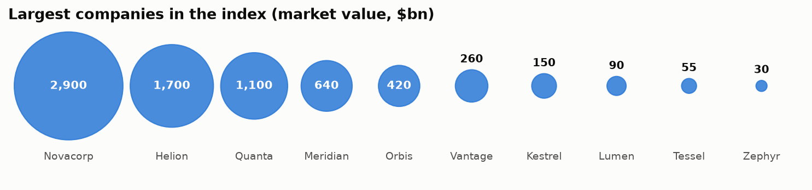 |

<a id="04-distribution"></a>
## 04 · Distribution

*Show values in a dataset and how often they occur; the shape (skew, spread, gaps) is the story.*

| Chart | Use it to… | Files | Preview |
|---|---|---|---|
| **Histogram** 🔀 | Show the shape of one numeric variable (normal, skewed, bimodal) | [ipynb](04_distribution/histogram/histogram.ipynb) · [py](04_distribution/histogram/histogram.py) | 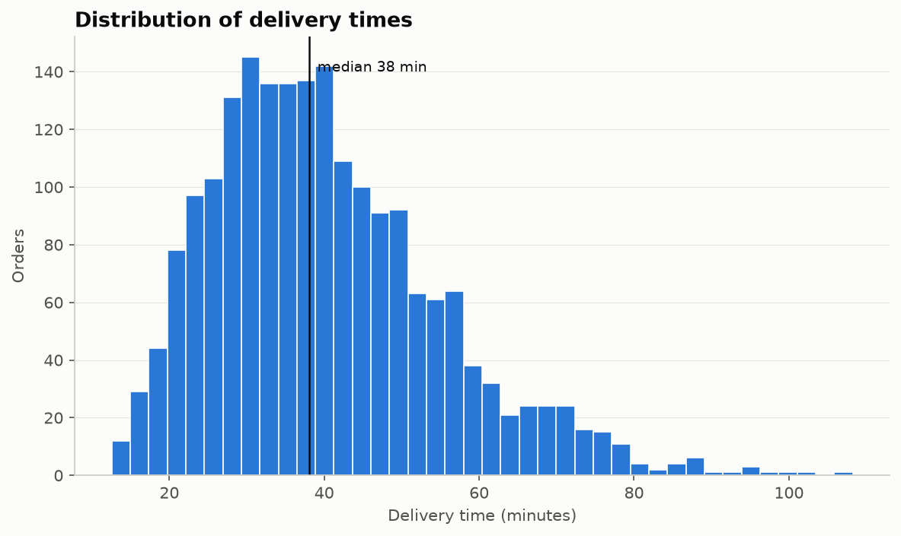 |
| **Density Plot (KDE)** ★🔀<br><sub>intermediate</sub> | Compare the shapes of two or three distributions on one axis | [ipynb](04_distribution/kde_density/kde_density.ipynb) · [py](04_distribution/kde_density/kde_density.py) | 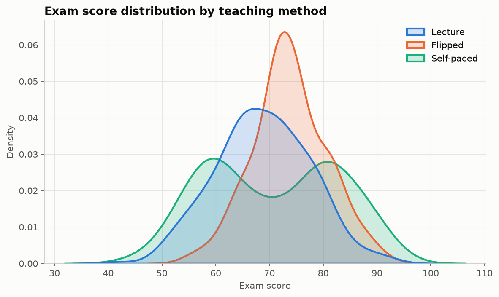 |
| **Box Plot (Box-and-Whisker)** 🔀<br><sub>intermediate</sub> | Compare the medians and spreads of many groups | [ipynb](04_distribution/box_plot/box_plot.ipynb) · [py](04_distribution/box_plot/box_plot.py) | 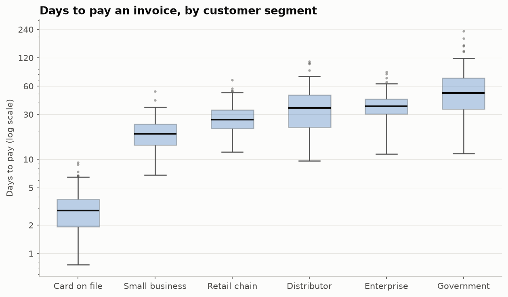 |
| **Violin Plot** ★🔀<br><sub>intermediate</sub> | Compare distributions across groups when the shape matters (bimodality, skew) | [ipynb](04_distribution/violin_plot/violin_plot.ipynb) · [py](04_distribution/violin_plot/violin_plot.py) | 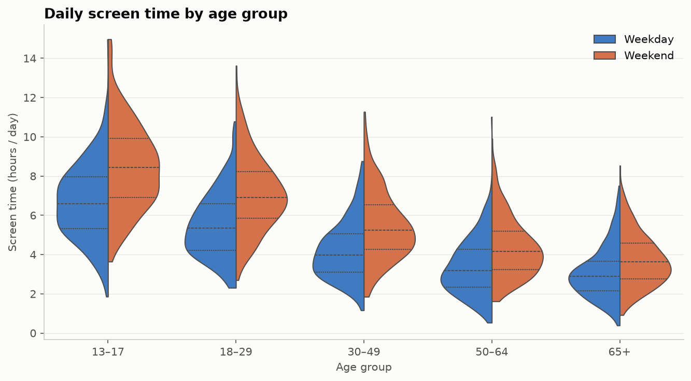 |
| **Strip Plot (Jittered Dots)**  | Show small to medium samples (under ~300 per group) where every point matters | [ipynb](04_distribution/strip_jitter/strip_jitter.ipynb) · [py](04_distribution/strip_jitter/strip_jitter.py) | 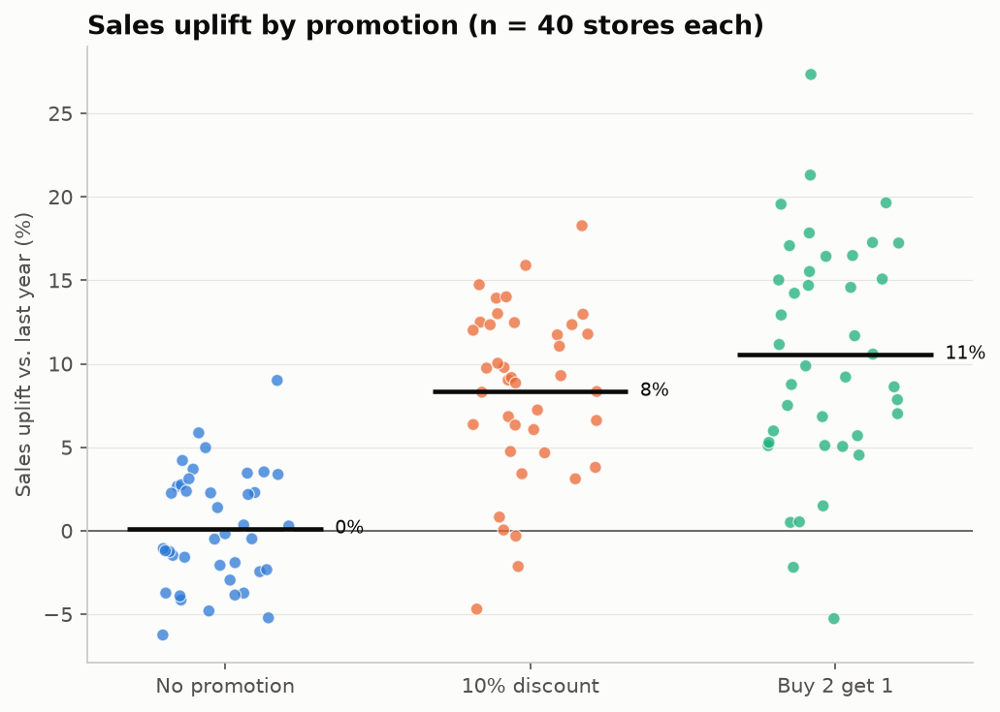 |
| **Beeswarm Plot** <br><sub>intermediate</sub> | Show individual observations and the distribution shape together | [ipynb](04_distribution/beeswarm/beeswarm.ipynb) · [py](04_distribution/beeswarm/beeswarm.py) | 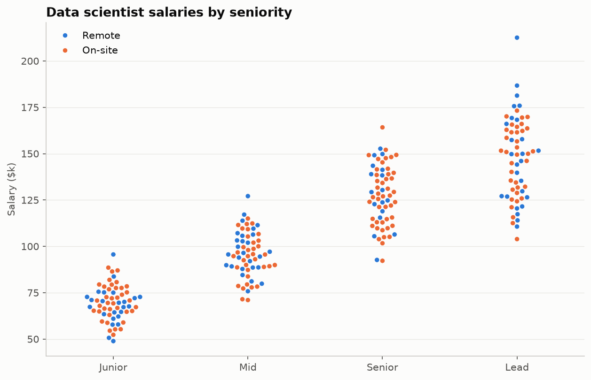 |
| **Ridgeline Plot (Joy Plot)** ★<br><sub>intermediate</sub> | Compare distributions across many groups (5–20), especially ordered ones like months or years | [ipynb](04_distribution/ridgeline/ridgeline.ipynb) · [py](04_distribution/ridgeline/ridgeline.py) | 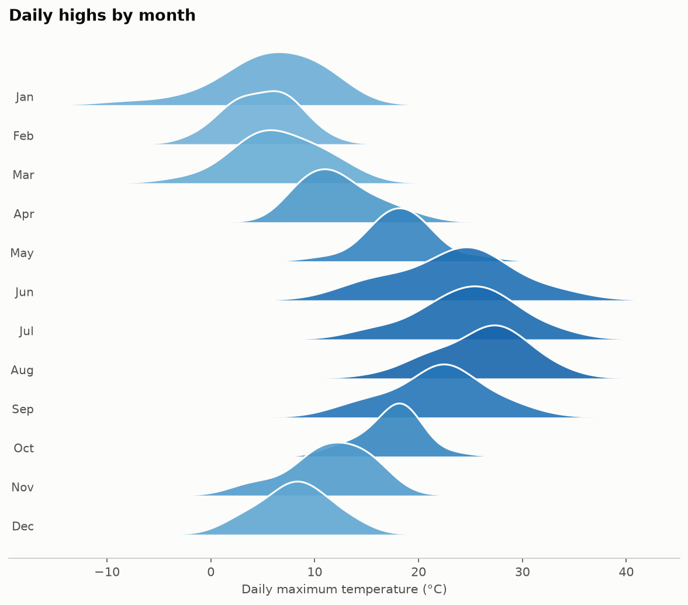 |
| **Empirical CDF (ECDF)** 🔀<br><sub>intermediate</sub> | Compare distributions precisely, with no binning choices | [ipynb](04_distribution/ecdf/ecdf.ipynb) · [py](04_distribution/ecdf/ecdf.py) | 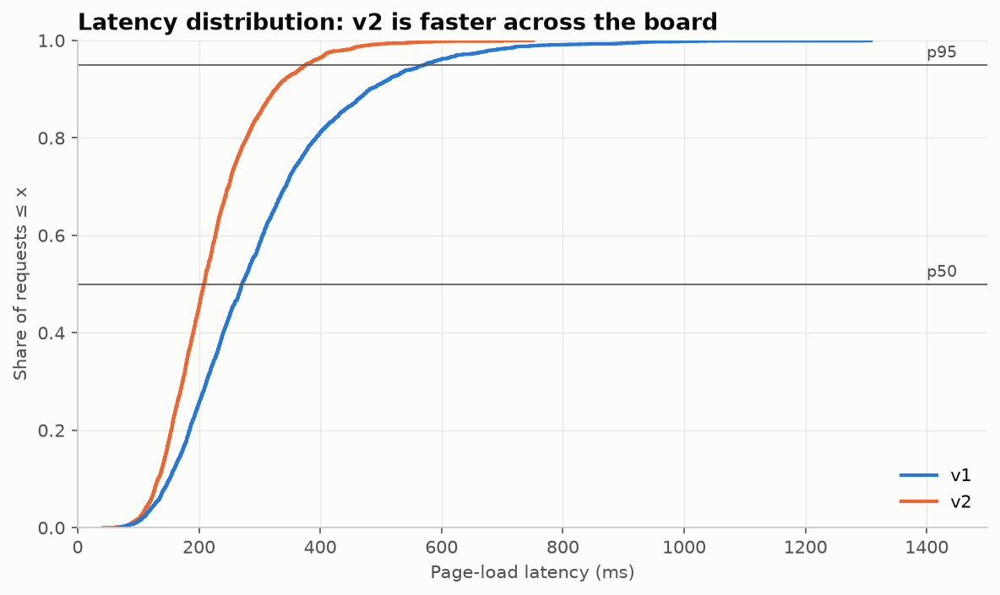 |
| **Population Pyramid**  | Show the age and sex structure of a population | [ipynb](04_distribution/population_pyramid/population_pyramid.ipynb) · [py](04_distribution/population_pyramid/population_pyramid.py) | 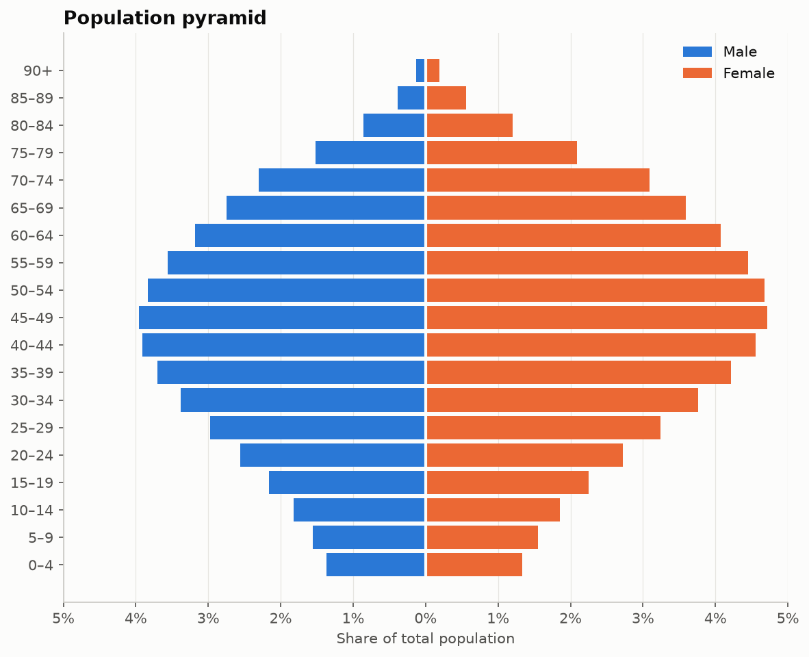 |
| **Raincloud Plot** <br><sub>intermediate</sub> | Compare groups in research reports where transparency matters | [ipynb](04_distribution/raincloud/raincloud.ipynb) · [py](04_distribution/raincloud/raincloud.py) | 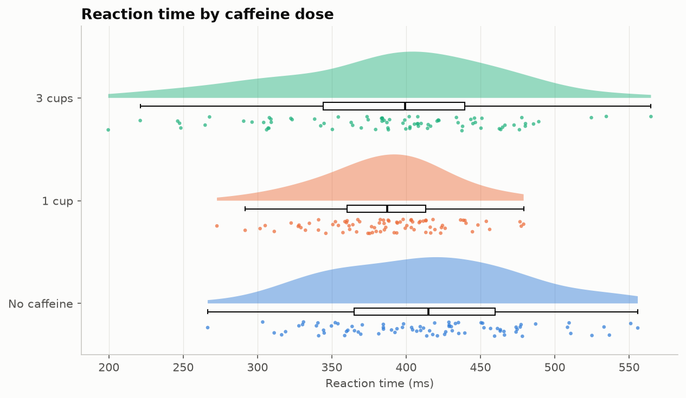 |
| **Barcode Plot (Rug Plot)** <br><sub>intermediate</sub> | Show exactly where individual values fall, for example to highlight one country among all of them | [ipynb](04_distribution/barcode_plot/barcode_plot.ipynb) · [py](04_distribution/barcode_plot/barcode_plot.py) | 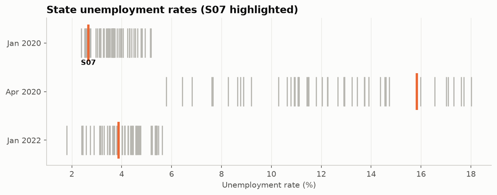 |
| **Q-Q Plot (Quantile-Quantile)** <br><sub>intermediate</sub> | Check the normality assumption before t-tests or regression (e.g. on residuals) | [ipynb](04_distribution/qq_plot/qq_plot.ipynb) · [py](04_distribution/qq_plot/qq_plot.py) | 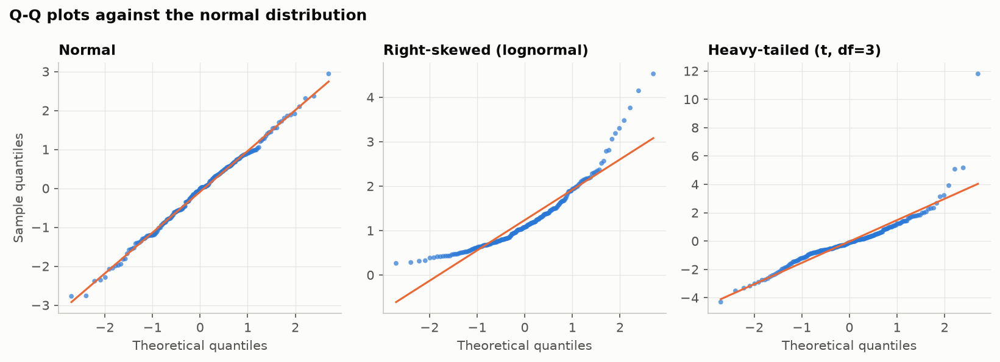 |

<a id="05-change-over-time"></a>
## 05 · Change over time

*Emphasise changing trends, from intraday moves to series spanning decades.*

| Chart | Use it to… | Files | Preview |
|---|---|---|---|
| **Line Chart** ★🔀 | Show a trend in a continuous measure over regular time intervals | [ipynb](05_change_over_time/line_chart/line_chart.ipynb) · [py](05_change_over_time/line_chart/line_chart.py) | 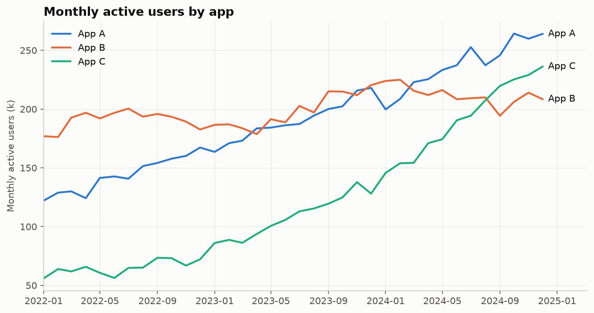 |
| **Highlighted Line Chart (one vs. many)**  | Show one entity in the context of many peers (your country vs. all others) | [ipynb](05_change_over_time/line_highlight/line_highlight.ipynb) · [py](05_change_over_time/line_highlight/line_highlight.py) | 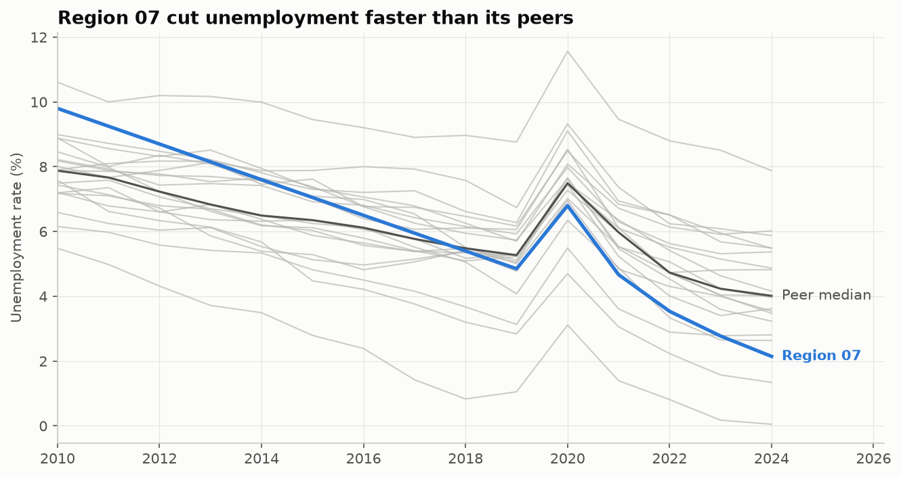 |
| **Small Multiples (line)** ★ | Compare trends across many groups (5–30) | [ipynb](05_change_over_time/small_multiples_line/small_multiples_line.ipynb) · [py](05_change_over_time/small_multiples_line/small_multiples_line.py) | 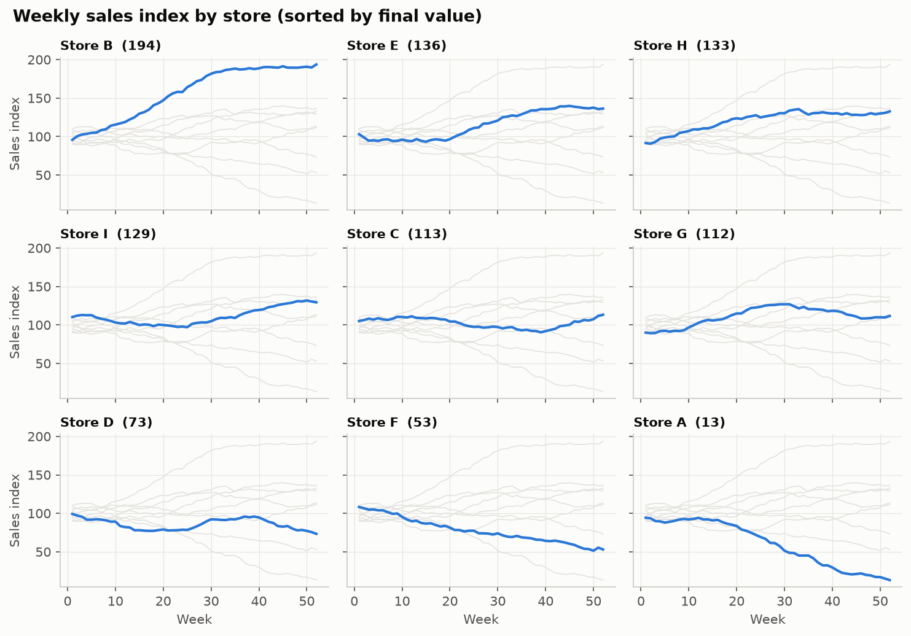 |
| **Area Chart** 🔀 | Show a single quantity whose magnitude (volume) matters, such as traffic, energy, or storage used | [ipynb](05_change_over_time/area_chart/area_chart.ipynb) · [py](05_change_over_time/area_chart/area_chart.py) | 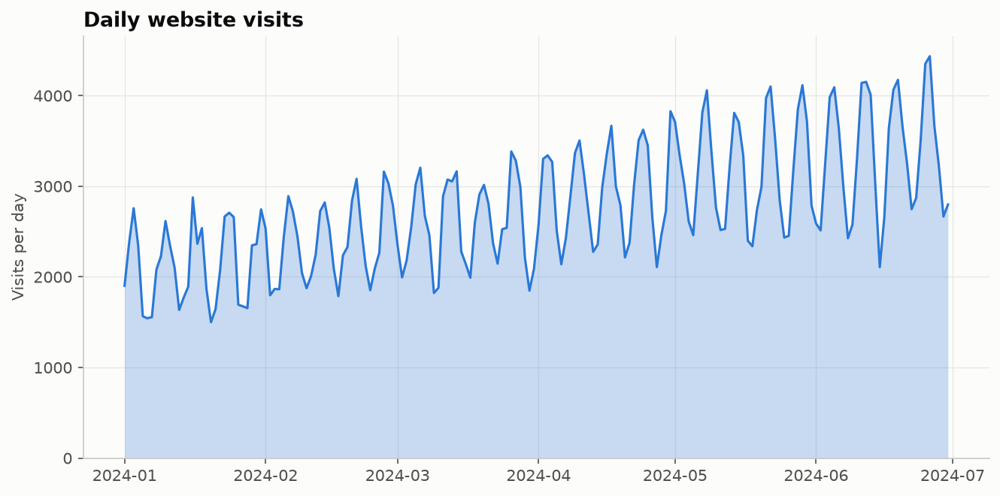 |
| **Stacked Area Chart** 🔀 | Show how a total changes over time and which components drive it | [ipynb](05_change_over_time/stacked_area/stacked_area.ipynb) · [py](05_change_over_time/stacked_area/stacked_area.py) | 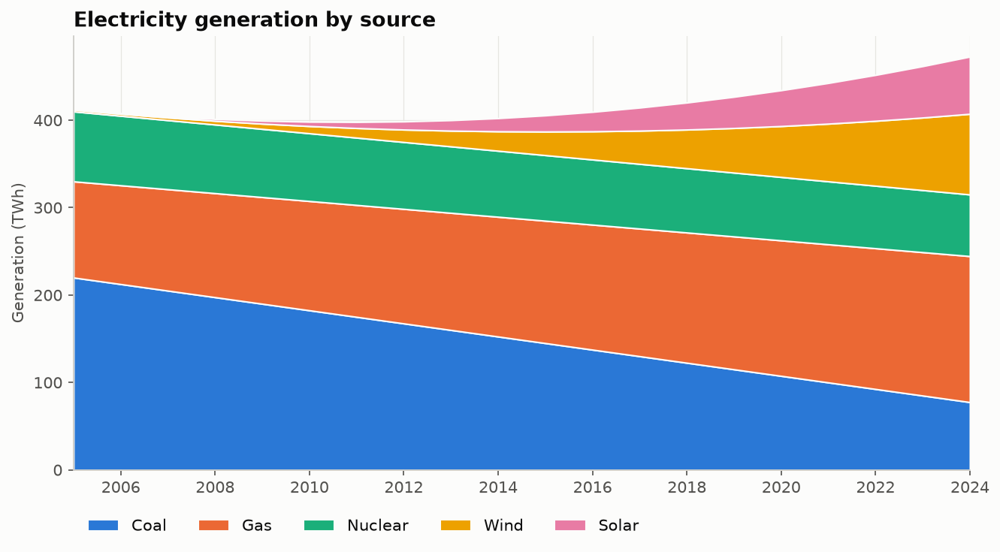 |
| **Streamgraph** <br><sub>intermediate</sub> | Show the ebb and flow of many categories over time (music genres, topics, species) | [ipynb](05_change_over_time/streamgraph/streamgraph.ipynb) · [py](05_change_over_time/streamgraph/streamgraph.py) | 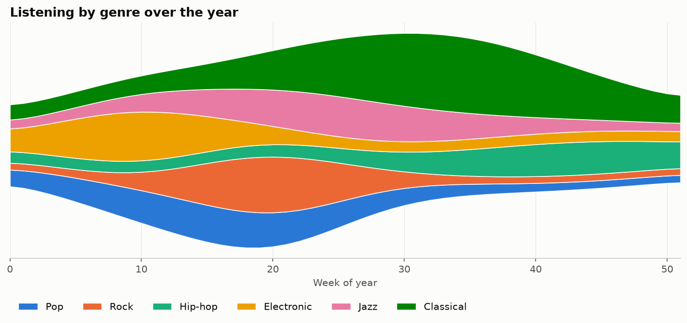 |
| **Step Line Chart**  | Show values that change at discrete moments and stay flat in between (interest rates, tariffs, headcount) | [ipynb](05_change_over_time/step_line/step_line.ipynb) · [py](05_change_over_time/step_line/step_line.py) | 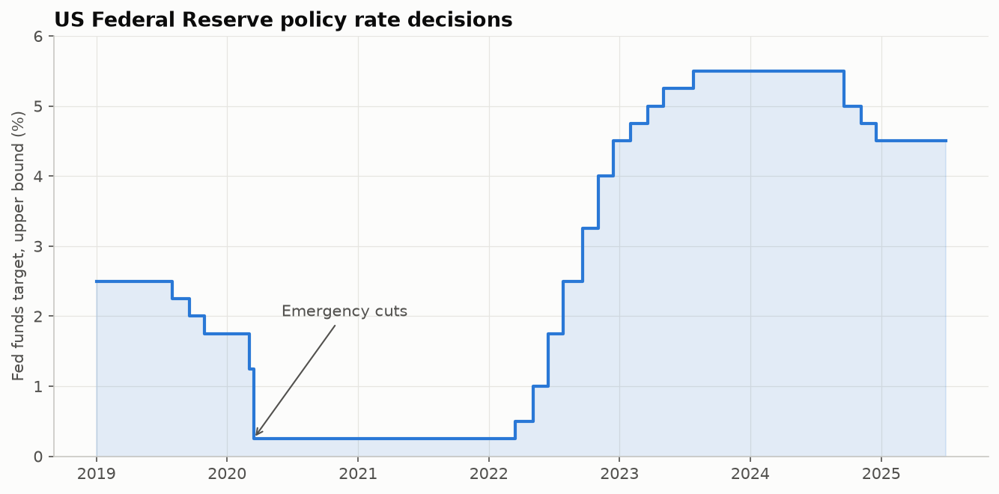 |
| **Candlestick (OHLC) Chart** <br><sub>intermediate</sub> | Show open, high, low and close prices of stocks, currencies or commodities | [ipynb](05_change_over_time/candlestick/candlestick.ipynb) · [py](05_change_over_time/candlestick/candlestick.py) | 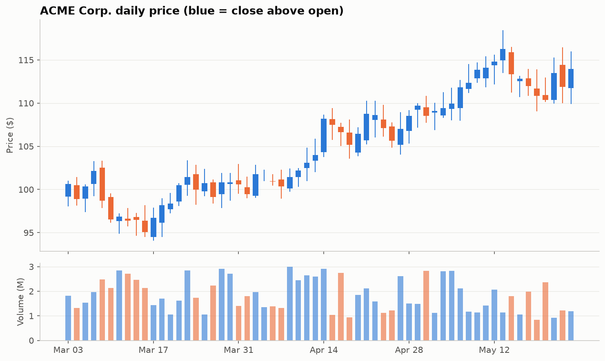 |
| **Fan Chart (forecast uncertainty)** <br><sub>intermediate</sub> | Show forecasts or projections with confidence or prediction intervals | [ipynb](05_change_over_time/fan_chart/fan_chart.ipynb) · [py](05_change_over_time/fan_chart/fan_chart.py) | 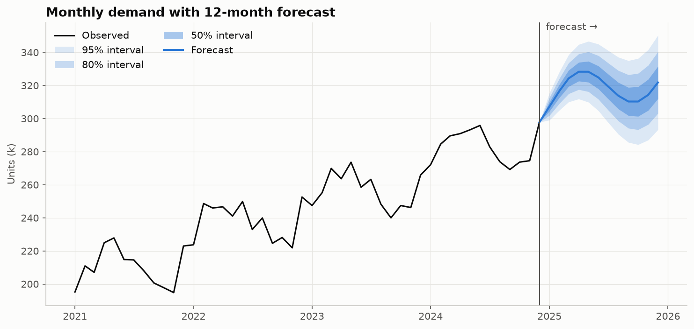 |
| **Calendar Heatmap** <br><sub>intermediate</sub> | Show daily data over months or years (activity, sales, commits, admissions) | [ipynb](05_change_over_time/calendar_heatmap/calendar_heatmap.ipynb) · [py](05_change_over_time/calendar_heatmap/calendar_heatmap.py) | 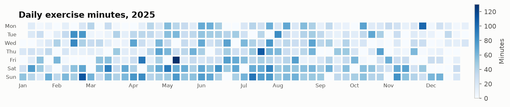 |
| **Gantt Chart**  | Plan or communicate project schedules, phases and milestones | [ipynb](05_change_over_time/gantt_chart/gantt_chart.ipynb) · [py](05_change_over_time/gantt_chart/gantt_chart.py) |  |
| **Sparklines**  | Dashboards and tables where each row needs trend context | [ipynb](05_change_over_time/sparklines/sparklines.ipynb) · [py](05_change_over_time/sparklines/sparklines.py) |  |
| **Seasonal (Cycle) Plot** <br><sub>intermediate</sub> | Data has a strong seasonal cycle (retail, energy demand, flu cases, tourism) | [ipynb](05_change_over_time/seasonal_cycle_plot/seasonal_cycle_plot.ipynb) · [py](05_change_over_time/seasonal_cycle_plot/seasonal_cycle_plot.py) |  |
| **Indexed Line Chart (rebased to 100)** ★<br><sub>intermediate</sub> | Compare growth of series with very different magnitudes (a small-cap vs. an index) | [ipynb](05_change_over_time/indexed_line/indexed_line.ipynb) · [py](05_change_over_time/indexed_line/indexed_line.py) |  |
| **Event Timeline**  | Tell a historical narrative or company milestones | [ipynb](05_change_over_time/event_timeline/event_timeline.ipynb) · [py](05_change_over_time/event_timeline/event_timeline.py) |  |
| **ACF & PACF (Autocorrelation Plots)** <br><sub>intermediate</sub> | Check for seasonality and its period (spikes at lags 7, 12, 52…) | [ipynb](05_change_over_time/acf_pacf/acf_pacf.ipynb) · [py](05_change_over_time/acf_pacf/acf_pacf.py) |  |
| **STL Decomposition (Trend / Seasonal / Residual)** <br><sub>intermediate</sub> | Separate long-term growth from seasonality before reporting a trend | [ipynb](05_change_over_time/stl_decomposition/stl_decomposition.ipynb) · [py](05_change_over_time/stl_decomposition/stl_decomposition.py) |  |

<a id="06-magnitude"></a>
## 06 · Magnitude

*Compare sizes, relative or absolute (usually counts rather than rates).*

| Chart | Use it to… | Files | Preview |
|---|---|---|---|
| **Column Chart (vertical bar)**  | Compare values across a small number (≤ 12) of categories with short labels | [ipynb](06_magnitude/column_chart/column_chart.ipynb) · [py](06_magnitude/column_chart/column_chart.py) |  |
| **Horizontal Bar Chart (sorted)** 🔀 | Category names are long (countries, products, survey answers) | [ipynb](06_magnitude/horizontal_bar/horizontal_bar.ipynb) · [py](06_magnitude/horizontal_bar/horizontal_bar.py) |  |
| **Grouped (Clustered) Bar Chart** ★🔀 | Compare 2–4 sub-groups across a handful of categories (sales by region and year) | [ipynb](06_magnitude/grouped_bar/grouped_bar.ipynb) · [py](06_magnitude/grouped_bar/grouped_bar.py) |  |
| **Dumbbell Chart (connected dot plot)** ★🔀 | Compare two values per category (2015 vs. 2025, men vs. women, target vs. actual) | [ipynb](06_magnitude/dumbbell/dumbbell.ipynb) · [py](06_magnitude/dumbbell/dumbbell.py) |  |
| **Radar (Spider) Chart** ★<br><sub>intermediate</sub> | Compare the profile of 1–3 entities across 4–8 variables on the same scale (skills, product attributes) | [ipynb](06_magnitude/radar_chart/radar_chart.ipynb) · [py](06_magnitude/radar_chart/radar_chart.py) |  |
| **Parallel Coordinates** ★🔀<br><sub>intermediate</sub> | Explore multivariate data (4–12 numeric variables) for clusters and trade-offs | [ipynb](06_magnitude/parallel_coordinates/parallel_coordinates.ipynb) · [py](06_magnitude/parallel_coordinates/parallel_coordinates.py) |  |
| **Bullet Chart** <br><sub>intermediate</sub> | Show KPI performance against target and qualitative thresholds in dashboards | [ipynb](06_magnitude/bullet_chart/bullet_chart.ipynb) · [py](06_magnitude/bullet_chart/bullet_chart.py) |  |
| **Pictogram / Isotype Chart**  | Communicate counts or ratios to a broad public ('3 in 10 people…') | [ipynb](06_magnitude/pictogram_isotype/pictogram_isotype.ipynb) · [py](06_magnitude/pictogram_isotype/pictogram_isotype.py) |  |
| **Packed Bubble Chart (proportional symbols)**  | Show orders of magnitude when values differ greatly (large vs. small players) | [ipynb](06_magnitude/packed_bubbles/packed_bubbles.ipynb) · [py](06_magnitude/packed_bubbles/packed_bubbles.py) |  |
| **KPI Stat Tile (big number)**  | A single headline metric (one-bar charts and 2-slice pies should be tiles instead) | [ipynb](06_magnitude/kpi_stat_tile/kpi_stat_tile.ipynb) · [py](06_magnitude/kpi_stat_tile/kpi_stat_tile.py) |  |
| **Highlight Table (heat-shaded table)**  | Readers need exact numbers and patterns (finance reports, cross-tabs) | [ipynb](06_magnitude/highlight_table/highlight_table.ipynb) · [py](06_magnitude/highlight_table/highlight_table.py) |  |
| **Word Cloud**  | Give a quick first look at the themes of free-text responses, reviews or speeches | [ipynb](06_magnitude/word_cloud/word_cloud.ipynb) · [py](06_magnitude/word_cloud/word_cloud.py) |  |

<a id="07-part-to-whole"></a>
## 07 · Part-to-whole

*Show how a single entity breaks down into its components.*

| Chart | Use it to… | Files | Preview |
|---|---|---|---|
| **Stacked Bar Chart** 🔀 | Compare totals across categories and show roughly what makes them up | [ipynb](07_part_to_whole/stacked_bar/stacked_bar.ipynb) · [py](07_part_to_whole/stacked_bar/stacked_bar.py) |  |
| **100% Stacked Bar Chart**  | Compare proportions across groups whose totals differ a lot | [ipynb](07_part_to_whole/percent_stacked_bar/percent_stacked_bar.ipynb) · [py](07_part_to_whole/percent_stacked_bar/percent_stacked_bar.py) |  |
| **Pie Chart** 🔀 | Show a simple part-to-whole split with few slices (≤ 6, ideally 2–4) | [ipynb](07_part_to_whole/pie_chart/pie_chart.ipynb) · [py](07_part_to_whole/pie_chart/pie_chart.py) |  |
| **Donut Chart**  | Show a part-to-whole split with few categories (≤ 6) and a headline figure | [ipynb](07_part_to_whole/donut_chart/donut_chart.ipynb) · [py](07_part_to_whole/donut_chart/donut_chart.py) |  |
| **Treemap** 🔀 | Show part-to-whole with many categories (10–50+) where a pie would fail | [ipynb](07_part_to_whole/treemap/treemap.ipynb) · [py](07_part_to_whole/treemap/treemap.py) |  |
| **Sunburst Chart** <br><sub>intermediate</sub> | Show part-to-whole across 2–4 levels of hierarchy | [ipynb](07_part_to_whole/sunburst/sunburst.ipynb) · [py](07_part_to_whole/sunburst/sunburst.py) · [interactive](https://maxyychen.github.io/visualisation/07_part_to_whole/sunburst/sunburst.html) |  |
| **Icicle Chart** <br><sub>intermediate</sub> | Show hierarchical part-to-whole where labels are long | [ipynb](07_part_to_whole/icicle/icicle.ipynb) · [py](07_part_to_whole/icicle/icicle.py) · [interactive](https://maxyychen.github.io/visualisation/07_part_to_whole/icicle/icicle.html) |  |
| **Waffle Chart**  | Communicate a few percentages to a general audience ('23 in every 100 customers') | [ipynb](07_part_to_whole/waffle_chart/waffle_chart.ipynb) · [py](07_part_to_whole/waffle_chart/waffle_chart.py) |  |
| **Marimekko (Mosaic) Chart** <br><sub>intermediate</sub> | Show market size by segment together with share within each segment | [ipynb](07_part_to_whole/marimekko/marimekko.ipynb) · [py](07_part_to_whole/marimekko/marimekko.py) |  |
| **Waterfall Chart** <br><sub>intermediate</sub> | Bridge from one total to another (revenue → profit, last year → this year) | [ipynb](07_part_to_whole/waterfall_chart/waterfall_chart.ipynb) · [py](07_part_to_whole/waterfall_chart/waterfall_chart.py) |  |
| **Venn Diagram**  | Show overlap between 2–3 groups (customers holding products A, B, C) | [ipynb](07_part_to_whole/venn_diagram/venn_diagram.ipynb) · [py](07_part_to_whole/venn_diagram/venn_diagram.py) |  |
| **Parliament (Semicircle) Chart**  | Show seat allocation in a legislature or committee | [ipynb](07_part_to_whole/parliament_chart/parliament_chart.ipynb) · [py](07_part_to_whole/parliament_chart/parliament_chart.py) |  |

<a id="08-spatial"></a>
## 08 · Spatial

*Use when precise locations or geographic patterns matter more than anything else.*

| Chart | Use it to… | Files | Preview |
|---|---|---|---|
| **Choropleth Map (world)**  | Show a rate, ratio or index (life expectancy, % vaccinated) across countries or regions | [ipynb](08_spatial/choropleth_world/choropleth_world.ipynb) · [py](08_spatial/choropleth_world/choropleth_world.py) · [interactive](https://maxyychen.github.io/visualisation/08_spatial/choropleth_world/choropleth_world.html) |  |
| **Choropleth Map (US states)**  | Show a state-level rate or index for a US audience | [ipynb](08_spatial/choropleth_us_states/choropleth_us_states.ipynb) · [py](08_spatial/choropleth_us_states/choropleth_us_states.py) · [interactive](https://maxyychen.github.io/visualisation/08_spatial/choropleth_us_states/choropleth_us_states.html) |  |
| **Bubble Map (proportional symbols)**  | Show counts or totals at point locations (city population, store revenue, case counts) | [ipynb](08_spatial/bubble_map/bubble_map.ipynb) · [py](08_spatial/bubble_map/bubble_map.py) · [interactive](https://maxyychen.github.io/visualisation/08_spatial/bubble_map/bubble_map.html) |  |
| **Flow Map (origin–destination)** <br><sub>intermediate</sub> | Show movement between places (flights, migration, trade, capital flows) | [ipynb](08_spatial/flow_map/flow_map.ipynb) · [py](08_spatial/flow_map/flow_map.py) · [interactive](https://maxyychen.github.io/visualisation/08_spatial/flow_map/flow_map.html) |  |
| **Tile Grid Map**  | Every region should count equally (US states, EU countries, districts) | [ipynb](08_spatial/tile_grid_map/tile_grid_map.ipynb) · [py](08_spatial/tile_grid_map/tile_grid_map.py) |  |
| **Contour / Isarithmic Map** <br><sub>intermediate</sub> | Show a continuous phenomenon that varies smoothly over space (elevation, rainfall, temperature, pollution) | [ipynb](08_spatial/contour_map/contour_map.ipynb) · [py](08_spatial/contour_map/contour_map.py) |  |
| **Value-Suppressing Uncertainty Palette (VSUP) Map** 📄<br><sub>advanced</sub> | Mapping estimates whose precision varies a lot between regions (survey rates, small-area statistics, model estimates) | [ipynb](08_spatial/vsup_map/vsup_map.ipynb) · [py](08_spatial/vsup_map/vsup_map.py) |  |
| **Bayesian Surprise Map** 📄<br><sub>advanced</sub> | Mapping event counts (fraud, defaults, claims, incidents) across regions of very different size | [ipynb](08_spatial/surprise_map/surprise_map.ipynb) · [py](08_spatial/surprise_map/surprise_map.py) |  |
| **Hexagonal Grid Map (hexbin)** <br><sub>intermediate</sub> | Map dense point data (transactions, deliveries, incidents, sensor readings) over a city or region | [ipynb](08_spatial/hexgrid_map/hexgrid_map.ipynb) · [py](08_spatial/hexgrid_map/hexgrid_map.py) |  |
| **3-D Hexagon Columns Map (pydeck)** <br><sub>advanced</sub> | Explore very dense point data interactively (tens of thousands to millions of points) | [ipynb](08_spatial/pydeck_3d_columns/pydeck_3d_columns.ipynb) · [py](08_spatial/pydeck_3d_columns/pydeck_3d_columns.py) · [interactive](https://maxyychen.github.io/visualisation/08_spatial/pydeck_3d_columns/pydeck_3d_columns.html) |  |

<a id="09-flow"></a>
## 09 · Flow

*Show the volume or intensity of movement between states, stages, or places.*

| Chart | Use it to… | Files | Preview |
|---|---|---|---|
| **Sankey Diagram** <br><sub>intermediate</sub> | Show energy, money, or material flowing through a system | [ipynb](09_flow/sankey/sankey.ipynb) · [py](09_flow/sankey/sankey.py) · [interactive](https://maxyychen.github.io/visualisation/09_flow/sankey/sankey.html) |  |
| **Alluvial Diagram (Parallel Categories)** <br><sub>intermediate</sub> | Show how individuals move between categories over time (plan tier in 2024 → 2025) | [ipynb](09_flow/alluvial/alluvial.ipynb) · [py](09_flow/alluvial/alluvial.py) · [interactive](https://maxyychen.github.io/visualisation/09_flow/alluvial/alluvial.html) |  |
| **Funnel Chart** 🔀 | Show a sales or marketing conversion pipeline (visit → sign-up → purchase) | [ipynb](09_flow/funnel_chart/funnel_chart.ipynb) · [py](09_flow/funnel_chart/funnel_chart.py) |  |
| **Chord Diagram** <br><sub>intermediate</sub> | Show migration, trade, or transfers between a handful of entities in both directions | [ipynb](09_flow/chord_diagram/chord_diagram.ipynb) · [py](09_flow/chord_diagram/chord_diagram.py) |  |
| **Network Graph (Node-Link Diagram)** <br><sub>intermediate</sub> | Show relationships: collaboration, referral, citation, or communication networks | [ipynb](09_flow/network_graph/network_graph.ipynb) · [py](09_flow/network_graph/network_graph.py) |  |
| **Arc Diagram** <br><sub>intermediate</sub> | Show connections where node order matters (characters by first appearance, sequential steps) | [ipynb](09_flow/arc_diagram/arc_diagram.ipynb) · [py](09_flow/arc_diagram/arc_diagram.py) |  |
| **Origin–Destination Matrix (Flow Heatmap)** <br><sub>intermediate</sub> | Show many-to-many flows between 10–50 places (commuting, migration, referrals) | [ipynb](09_flow/origin_destination_matrix/origin_destination_matrix.ipynb) · [py](09_flow/origin_destination_matrix/origin_destination_matrix.py) |  |
| **Hierarchical Edge Bundling** <br><sub>advanced</sub> | Show many connections (100s) between items that belong to a known hierarchy | [ipynb](09_flow/hierarchical_edge_bundling/hierarchical_edge_bundling.ipynb) · [py](09_flow/hierarchical_edge_bundling/hierarchical_edge_bundling.py) |  |
| **Adjacency Matrix (ordered)** <br><sub>intermediate</sub> | Show dense networks (dozens to hundreds of nodes) where a node-link drawing becomes a hairball | [ipynb](09_flow/adjacency_matrix/adjacency_matrix.ipynb) · [py](09_flow/adjacency_matrix/adjacency_matrix.py) |  |

<a id="10-finance-investment"></a>
## 10 · Finance & investment

*Performance, risk, portfolios, markets, rates, derivatives and valuation, the everyday charts of investors and analysts.*

| Chart | Use it to… | Files | Preview |
|---|---|---|---|
| **Performance Tear Sheet (one-page report)** ★<br><sub>intermediate</sub> | Summarise a fund, strategy, or portfolio's track record on one page | [ipynb](10_finance_investment/performance_tear_sheet/performance_tear_sheet.ipynb) · [py](10_finance_investment/performance_tear_sheet/performance_tear_sheet.py) |  |
| **Cumulative Return vs. Benchmark** ★ | Compare long-run performance of a fund, strategy or stock against a benchmark | [ipynb](10_finance_investment/cumulative_return_benchmark/cumulative_return_benchmark.ipynb) · [py](10_finance_investment/cumulative_return_benchmark/cumulative_return_benchmark.py) |  |
| **Drawdown (Underwater) Chart** ★<br><sub>intermediate</sub> | Show the pain an investor would have experienced, not just the end result | [ipynb](10_finance_investment/drawdown_underwater/drawdown_underwater.ipynb) · [py](10_finance_investment/drawdown_underwater/drawdown_underwater.py) |  |
| **Monthly Returns Heatmap (Calendar Table)** ★ | Summarise a multi-year monthly track record on one page | [ipynb](10_finance_investment/monthly_returns_heatmap/monthly_returns_heatmap.ipynb) · [py](10_finance_investment/monthly_returns_heatmap/monthly_returns_heatmap.py) |  |
| **Annual Returns vs. Benchmark**  | Report calendar-year performance against a benchmark | [ipynb](10_finance_investment/annual_returns_bar/annual_returns_bar.ipynb) · [py](10_finance_investment/annual_returns_bar/annual_returns_bar.py) |  |
| **Rolling Return, Volatility and Sharpe** ★<br><sub>intermediate</sub> | Check whether a strategy's edge is persistent or concentrated in one period | [ipynb](10_finance_investment/rolling_metrics/rolling_metrics.ipynb) · [py](10_finance_investment/rolling_metrics/rolling_metrics.py) |  |
| **Return Distribution with VaR and CVaR** ★<br><sub>intermediate</sub> | Explain tail risk and what VaR / CVaR actually measure | [ipynb](10_finance_investment/return_distribution_var/return_distribution_var.ipynb) · [py](10_finance_investment/return_distribution_var/return_distribution_var.py) |  |
| **Rolling Correlation** <br><sub>intermediate</sub> | Check whether a diversifier (bonds, gold, alternatives) still diversifies | [ipynb](10_finance_investment/rolling_correlation/rolling_correlation.ipynb) · [py](10_finance_investment/rolling_correlation/rolling_correlation.py) |  |
| **Risk Contribution vs. Capital Weight** ★<br><sub>advanced</sub> | Show where a portfolio's risk really comes from | [ipynb](10_finance_investment/risk_contribution/risk_contribution.ipynb) · [py](10_finance_investment/risk_contribution/risk_contribution.py) |  |
| **Stress-Test Tornado Chart** <br><sub>intermediate</sub> | Rank the sensitivity of a portfolio, valuation or budget to individual assumptions | [ipynb](10_finance_investment/stress_test_tornado/stress_test_tornado.ipynb) · [py](10_finance_investment/stress_test_tornado/stress_test_tornado.py) |  |
| **Efficient Frontier** ★<br><sub>intermediate</sub> | Explain diversification and the risk-return trade-off | [ipynb](10_finance_investment/efficient_frontier/efficient_frontier.ipynb) · [py](10_finance_investment/efficient_frontier/efficient_frontier.py) |  |
| **Risk-Return Scatter** ★<br><sub>intermediate</sub> | Compare a fund with its peer group or a set of indices | [ipynb](10_finance_investment/risk_return_scatter/risk_return_scatter.ipynb) · [py](10_finance_investment/risk_return_scatter/risk_return_scatter.py) |  |
| **Allocation Drift and Rebalancing** <br><sub>intermediate</sub> | Explain why and how often to rebalance | [ipynb](10_finance_investment/allocation_drift/allocation_drift.ipynb) · [py](10_finance_investment/allocation_drift/allocation_drift.py) |  |
| **Performance Attribution (Brinson)** <br><sub>advanced</sub> | Explain why a fund beat or lagged its benchmark over a period | [ipynb](10_finance_investment/brinson_attribution/brinson_attribution.ipynb) · [py](10_finance_investment/brinson_attribution/brinson_attribution.py) |  |
| **Factor Exposure (Betas with Confidence Intervals)** <br><sub>advanced</sub> | Look past a fund's label to the systematic risks it takes | [ipynb](10_finance_investment/factor_exposure/factor_exposure.ipynb) · [py](10_finance_investment/factor_exposure/factor_exposure.py) |  |
| **Candlestick with Moving Averages, Bollinger Band & Volume** <br><sub>intermediate</sub> | Review a single security's recent price action with trend and volatility context | [ipynb](10_finance_investment/candlestick_ma_volume/candlestick_ma_volume.ipynb) · [py](10_finance_investment/candlestick_ma_volume/candlestick_ma_volume.py) |  |
| **Market Map (Sector Treemap Heatmap)**  | Give a one-glance summary of the market or a portfolio on a given day or period | [ipynb](10_finance_investment/sector_heatmap/sector_heatmap.ipynb) · [py](10_finance_investment/sector_heatmap/sector_heatmap.py) |  |
| **Relative Rotation Graph (RRG)** <br><sub>advanced</sub> | Compare sector or asset-class leadership relative to a benchmark | [ipynb](10_finance_investment/relative_rotation_graph/relative_rotation_graph.ipynb) · [py](10_finance_investment/relative_rotation_graph/relative_rotation_graph.py) |  |
| **Market Breadth Panels** <br><sub>intermediate</sub> | Check if an index move reflects most stocks or a handful of mega-caps | [ipynb](10_finance_investment/market_breadth/market_breadth.ipynb) · [py](10_finance_investment/market_breadth/market_breadth.py) |  |
| **Yield Curve (with Inversion)** <br><sub>intermediate</sub> | Compare the term structure of interest rates at several points in time | [ipynb](10_finance_investment/yield_curve/yield_curve.ipynb) · [py](10_finance_investment/yield_curve/yield_curve.py) |  |
| **Yield Curve History (Heatmap + Spread)** <br><sub>intermediate</sub> | Show how the entire yield curve evolved over years or decades | [ipynb](10_finance_investment/yield_curve_history/yield_curve_history.ipynb) · [py](10_finance_investment/yield_curve_history/yield_curve_history.py) |  |
| **Option Payoff Diagrams** <br><sub>intermediate</sub> | Explain or compare option strategies (directional, hedging, volatility, income) | [ipynb](10_finance_investment/option_payoff/option_payoff.ipynb) · [py](10_finance_investment/option_payoff/option_payoff.py) |  |
| **Implied Volatility Smile & Surface** <br><sub>advanced</sub> | Show equity skew: downside puts priced at higher volatility than upside calls | [ipynb](10_finance_investment/volatility_smile_surface/volatility_smile_surface.ipynb) · [py](10_finance_investment/volatility_smile_surface/volatility_smile_surface.py) |  |
| **Football Field (Valuation Summary)** <br><sub>intermediate</sub> | Summarise several valuation approaches on one common scale (value per share or EV) | [ipynb](10_finance_investment/football_field_valuation/football_field_valuation.ipynb) · [py](10_finance_investment/football_field_valuation/football_field_valuation.py) |  |
| **DCF Sensitivity Table** <br><sub>intermediate</sub> | Show how sensitive an intrinsic valuation is to its key inputs | [ipynb](10_finance_investment/dcf_sensitivity_table/dcf_sensitivity_table.ipynb) · [py](10_finance_investment/dcf_sensitivity_table/dcf_sensitivity_table.py) |  |
| **Income Statement Sankey** <br><sub>intermediate</sub> | Explain a company's profit and loss to non-accountants | [ipynb](10_finance_investment/income_statement_sankey/income_statement_sankey.ipynb) · [py](10_finance_investment/income_statement_sankey/income_statement_sankey.py) · [interactive](https://maxyychen.github.io/visualisation/10_finance_investment/income_statement_sankey/income_statement_sankey.html) |  |
| **Revenue Bridge (Price / Volume / Mix / FX)**  | Explain the change in revenue, profit or margin between two periods | [ipynb](10_finance_investment/revenue_bridge/revenue_bridge.ipynb) · [py](10_finance_investment/revenue_bridge/revenue_bridge.py) |  |
| **Monte Carlo Retirement Projection** <br><sub>intermediate</sub> | Retirement or endowment planning with regular withdrawals | [ipynb](10_finance_investment/monte_carlo_wealth/monte_carlo_wealth.ipynb) · [py](10_finance_investment/monte_carlo_wealth/monte_carlo_wealth.py) |  |
| **Lump Sum vs Dollar-Cost Averaging vs Cash**  | Investor education on compounding and on the cost of waiting in cash | [ipynb](10_finance_investment/compounding_dca/compounding_dca.ipynb) · [py](10_finance_investment/compounding_dca/compounding_dca.py) |  |
| **Correlation Network (Minimum Spanning Tree)** 📄<br><sub>advanced</sub> | Find clusters and "hub" stocks in a universe of 20–200 assets | [ipynb](10_finance_investment/correlation_network_mst/correlation_network_mst.ipynb) · [py](10_finance_investment/correlation_network_mst/correlation_network_mst.py) |  |
| **Hierarchical Risk Parity (Dendrogram + Weights)** 📄<br><sub>advanced</sub> | Explain or audit an HRP (or other cluster-based) allocation | [ipynb](10_finance_investment/hrp_dendrogram/hrp_dendrogram.ipynb) · [py](10_finance_investment/hrp_dendrogram/hrp_dendrogram.py) |  |
| **Regime-Shaded Price Chart** <br><sub>advanced</sub> | Show when volatility or trend regimes switched, and how long they lasted | [ipynb](10_finance_investment/regime_shading/regime_shading.ipynb) · [py](10_finance_investment/regime_shading/regime_shading.py) |  |
| **Event Study (Cumulative Abnormal Returns)** <br><sub>advanced</sub> | Measure the average price reaction to a type of event (earnings, dividends, rate decisions, index inclusion) | [ipynb](10_finance_investment/event_study/event_study.ipynb) · [py](10_finance_investment/event_study/event_study.py) |  |
| **Order Book Depth & Liquidity Heatmap** <br><sub>advanced</sub> | Explain liquidity, spread and market impact to traders or execution analysts | [ipynb](10_finance_investment/order_book_depth/order_book_depth.ipynb) · [py](10_finance_investment/order_book_depth/order_book_depth.py) |  |
| **Futures Term Structure (Contango vs. Backwardation)** <br><sub>advanced</sub> | Explain roll yield and why commodity ETFs can lag spot prices | [ipynb](10_finance_investment/futures_term_structure/futures_term_structure.ipynb) · [py](10_finance_investment/futures_term_structure/futures_term_structure.py) |  |
| **Rolling Beta with Confidence Band** ★<br><sub>advanced</sub> | Monitor whether a fund's market exposure is drifting from its mandate | [ipynb](10_finance_investment/rolling_beta_ci/rolling_beta_ci.ipynb) · [py](10_finance_investment/rolling_beta_ci/rolling_beta_ci.py) |  |
| **Tail Dependence (Joint Crashes)** <br><sub>advanced</sub> | Stress-test a diversification claim ("they're only 0.4 correlated") | [ipynb](10_finance_investment/tail_dependence/tail_dependence.ipynb) · [py](10_finance_investment/tail_dependence/tail_dependence.py) |  |
| **Triangulated Maximally Filtered Graph (TMFG)** 📄<br><sub>advanced</sub> | Mapping the dependency structure of a portfolio or market (dozens to hundreds of assets) | [ipynb](10_finance_investment/tmfg_network/tmfg_network.ipynb) · [py](10_finance_investment/tmfg_network/tmfg_network.py) |  |

<a id="11-healthcare"></a>
## 11 · Healthcare & life sciences

*Clinical trials, survival, oncology, hospital quality and operations, epidemiology and patient-level records.*

| Chart | Use it to… | Files | Preview |
|---|---|---|---|
| **CONSORT Flow Diagram**  | Report any randomised controlled trial (required by the CONSORT statement and most journals) | [ipynb](11_healthcare/consort_diagram/consort_diagram.ipynb) · [py](11_healthcare/consort_diagram/consort_diagram.py) |  |
| **Kaplan–Meier Survival Curve** ★<br><sub>intermediate</sub> | Compare overall survival, progression-free survival or time-to-relapse between treatment arms or risk groups | [ipynb](11_healthcare/kaplan_meier/kaplan_meier.ipynb) · [py](11_healthcare/kaplan_meier/kaplan_meier.py) |  |
| **Cumulative Incidence (Competing Risks)** <br><sub>advanced</sub> | Show time-to-event outcomes where a competing event removes patients from risk (death before relapse, transplant before death) | [ipynb](11_healthcare/cumulative_incidence/cumulative_incidence.ipynb) · [py](11_healthcare/cumulative_incidence/cumulative_incidence.py) |  |
| **Swimmer Plot** <br><sub>intermediate</sub> | Show individual treatment duration and response in early-phase oncology trials | [ipynb](11_healthcare/swimmer_plot/swimmer_plot.ipynb) · [py](11_healthcare/swimmer_plot/swimmer_plot.py) |  |
| **Tumour Response Waterfall Plot** <br><sub>intermediate</sub> | Show tumour shrinkage in single-arm or early-phase oncology trials | [ipynb](11_healthcare/tumor_response_waterfall/tumor_response_waterfall.ipynb) · [py](11_healthcare/tumor_response_waterfall/tumor_response_waterfall.py) |  |
| **Spider Plot (tumour change from baseline)** <br><sub>intermediate</sub> | Show depth, speed and durability of tumour response in early-phase oncology trials | [ipynb](11_healthcare/spider_plot/spider_plot.ipynb) · [py](11_healthcare/spider_plot/spider_plot.py) |  |
| **OncoPrint (Mutation Matrix)** <br><sub>advanced</sub> | Summarise the genomic landscape of a tumour cohort for a set of driver genes | [ipynb](11_healthcare/oncoprint/oncoprint.ipynb) · [py](11_healthcare/oncoprint/oncoprint.py) |  |
| **Mutation Lollipop Plot** <br><sub>advanced</sub> | Show where mutations fall along one gene or protein in a cohort | [ipynb](11_healthcare/mutation_lollipop/mutation_lollipop.ipynb) · [py](11_healthcare/mutation_lollipop/mutation_lollipop.py) |  |
| **Adverse Event Dot Plot (incidence and relative risk)** 📄<br><sub>advanced</sub> | Summarise many adverse event types from a two-arm trial on one page | [ipynb](11_healthcare/adverse_event_dotplot/adverse_event_dotplot.ipynb) · [py](11_healthcare/adverse_event_dotplot/adverse_event_dotplot.py) |  |
| **Nomogram** <br><sub>advanced</sub> | Turn a logistic or Cox model into a tool clinicians can use by hand | [ipynb](11_healthcare/nomogram/nomogram.ipynb) · [py](11_healthcare/nomogram/nomogram.py) |  |
| **Decision Curve Analysis** 📄<br><sub>advanced</sub> | Judge whether a risk model or biomarker would improve decisions (biopsy, adjuvant therapy, screening) | [ipynb](11_healthcare/decision_curve/decision_curve.ipynb) · [py](11_healthcare/decision_curve/decision_curve.py) |  |
| **Run Chart (quality improvement)** 📄<br><sub>intermediate</sub> | Judge whether a change (new protocol, staffing, audit) actually improved a process measure | [ipynb](11_healthcare/spc_run_chart/spc_run_chart.ipynb) · [py](11_healthcare/spc_run_chart/spc_run_chart.py) |  |
| **Control Charts (p-chart and u-chart)** 📄<br><sub>intermediate</sub> | Monitor a quality or safety indicator whose denominator changes from period to period | [ipynb](11_healthcare/spc_control_chart/spc_control_chart.ipynb) · [py](11_healthcare/spc_control_chart/spc_control_chart.py) |  |
| **VLAD and Risk-Adjusted CUSUM (surgical outcomes)** 📄<br><sub>advanced</sub> | Monitor a surgeon, team or unit continuously, operation by operation, rather than in quarterly batches | [ipynb](11_healthcare/vlad_cusum/vlad_cusum.ipynb) · [py](11_healthcare/vlad_cusum/vlad_cusum.py) |  |
| **Hospital Funnel Plot (readmission rates)** 📄<br><sub>intermediate</sub> | Compare readmission, mortality or infection rates across hospitals, wards or surgeons of very different size | [ipynb](11_healthcare/hospital_funnel_plot/hospital_funnel_plot.ipynb) · [py](11_healthcare/hospital_funnel_plot/hospital_funnel_plot.py) |  |
| **Epidemic Curve with Time-Varying Rt** 📄<br><sub>advanced</sub> | Track an outbreak and judge whether control measures are working | [ipynb](11_healthcare/epidemic_curve_rt/epidemic_curve_rt.ipynb) · [py](11_healthcare/epidemic_curve_rt/epidemic_curve_rt.py) |  |
| **Patient Timeline (LifeLines-style record overview)** 📄<br><sub>intermediate</sub> | Review a single patient's history at a glance (case review, care coordination, clinical teaching) | [ipynb](11_healthcare/patient_timeline/patient_timeline.ipynb) · [py](11_healthcare/patient_timeline/patient_timeline.py) |  |
| **Lab Results with Reference Ranges**  | Review a patient's lab trends at a glance (rounds, case review, patient portals) | [ipynb](11_healthcare/lab_reference_ranges/lab_reference_ranges.ipynb) · [py](11_healthcare/lab_reference_ranges/lab_reference_ranges.py) |  |
| **Spaghetti Plot (Longitudinal Trajectories)** <br><sub>intermediate</sub> | Show repeated lab values, vital signs or scores per patient over follow-up visits | [ipynb](11_healthcare/spaghetti_longitudinal/spaghetti_longitudinal.ipynb) · [py](11_healthcare/spaghetti_longitudinal/spaghetti_longitudinal.py) |  |

<a id="12-scientific"></a>
## 12 · Scientific

*Domain-neutral statistics and research plots: effect sizes, meta-analysis, agreement, omics, replicates and visual inference.*

| Chart | Use it to… | Files | Preview |
|---|---|---|---|
| **Forest Plot** <br><sub>intermediate</sub> | Show a meta-analysis that pools results from several studies | [ipynb](12_scientific/forest_plot/forest_plot.ipynb) · [py](12_scientific/forest_plot/forest_plot.py) |  |
| **Volcano Plot** <br><sub>advanced</sub> | Show differential gene or protein expression (RNA-seq, proteomics, metabolomics) | [ipynb](12_scientific/volcano_plot/volcano_plot.ipynb) · [py](12_scientific/volcano_plot/volcano_plot.py) |  |
| **Manhattan Plot** <br><sub>advanced</sub> | Show genome-wide association studies (GWAS) or epigenome-wide scans | [ipynb](12_scientific/manhattan_plot/manhattan_plot.ipynb) · [py](12_scientific/manhattan_plot/manhattan_plot.py) |  |
| **Bland–Altman Plot** <br><sub>intermediate</sub> | Compare a new measurement device or assay with a reference standard | [ipynb](12_scientific/bland_altman/bland_altman.ipynb) · [py](12_scientific/bland_altman/bland_altman.py) |  |
| **Clustered Heatmap (with dendrograms)** ★<br><sub>advanced</sub> | Show gene expression signatures across samples | [ipynb](12_scientific/clustered_heatmap/clustered_heatmap.ipynb) · [py](12_scientific/clustered_heatmap/clustered_heatmap.py) |  |
| **Means with 95% Confidence Intervals** <br><sub>intermediate</sub> | Compare group means from experiments or trials (dose groups, conditions) | [ipynb](12_scientific/error_bar_ci/error_bar_ci.ipynb) · [py](12_scientific/error_bar_ci/error_bar_ci.py) |  |
| **UpSet Plot** 📄<br><sub>intermediate</sub> | Show the overlap of more than three sets (comorbidities, gene lists, mutation co-occurrence, survey multi-select answers) | [ipynb](12_scientific/upset_plot/upset_plot.ipynb) · [py](12_scientific/upset_plot/upset_plot.py) |  |
| **Estimation Plot (Gardner–Altman & Cumming)** 📄<br><sub>intermediate</sub> | Report an A/B test or experiment where the size of the effect matters more than "significant or not" | [ipynb](12_scientific/estimation_plot/estimation_plot.ipynb) · [py](12_scientific/estimation_plot/estimation_plot.py) |  |
| **SuperPlot (replicate-aware comparison)** 📄<br><sub>intermediate</sub> | Data are nested, with many observations inside a few independent replicates (customers within markets, trades within days, cells within experiments) | [ipynb](12_scientific/superplot/superplot.ipynb) · [py](12_scientific/superplot/superplot.py) |  |
| **Lineup Protocol (visual inference)** 📄★<br><sub>advanced</sub> | Check whether a pattern you see (a trend, momentum, clustering, a spatial hot spot) is real or a trick of the eye | [ipynb](12_scientific/lineup_protocol/lineup_protocol.ipynb) · [py](12_scientific/lineup_protocol/lineup_protocol.py) |  |
| **Funnel Plot (institutional comparison)** 📄<br><sub>intermediate</sub> | Compare many funds, branches, traders or suppliers whose results rest on very different amounts of data | [ipynb](12_scientific/funnel_plot/funnel_plot.ipynb) · [py](12_scientific/funnel_plot/funnel_plot.py) |  |

<a id="13-machine-learning"></a>
## 13 · Machine learning

*Evaluate and explain fitted models: classification performance, calibration, learning curves, residuals, feature importance and feature effects.*

| Chart | Use it to… | Files | Preview |
|---|---|---|---|
| **ROC Curve** ★<br><sub>intermediate</sub> | Compare the discriminative ability of diagnostic tests or ML classifiers | [ipynb](13_machine_learning/roc_curve/roc_curve.ipynb) · [py](13_machine_learning/roc_curve/roc_curve.py) |  |
| **Precision–Recall Curve** ★<br><sub>intermediate</sub> | Evaluate classifiers on imbalanced data (rare disease screening, fraud, defects) | [ipynb](13_machine_learning/precision_recall_curve/precision_recall_curve.ipynb) · [py](13_machine_learning/precision_recall_curve/precision_recall_curve.py) |  |
| **Calibration (Reliability) Plot** <br><sub>intermediate</sub> | Evaluate clinical risk scores and any model whose probabilities drive decisions | [ipynb](13_machine_learning/calibration_plot/calibration_plot.ipynb) · [py](13_machine_learning/calibration_plot/calibration_plot.py) |  |
| **Confusion Matrix** ★<br><sub>intermediate</sub> | Show which classes a classifier confuses with each other | [ipynb](13_machine_learning/confusion_matrix/confusion_matrix.ipynb) · [py](13_machine_learning/confusion_matrix/confusion_matrix.py) |  |
| **Learning Curve** <br><sub>intermediate</sub> | Decide whether collecting more data is likely to improve a model | [ipynb](13_machine_learning/learning_curve/learning_curve.ipynb) · [py](13_machine_learning/learning_curve/learning_curve.py) |  |
| **Regression Residual Diagnostics** <br><sub>advanced</sub> | Validate any linear or generalized linear model before reporting it | [ipynb](13_machine_learning/residual_diagnostics/residual_diagnostics.ipynb) · [py](13_machine_learning/residual_diagnostics/residual_diagnostics.py) |  |
| **Permutation Feature Importance** <br><sub>intermediate</sub> | Rank the features any fitted model relies on (model-agnostic) | [ipynb](13_machine_learning/permutation_importance/permutation_importance.ipynb) · [py](13_machine_learning/permutation_importance/permutation_importance.py) |  |
| **SHAP Summary (Beeswarm)** <br><sub>advanced</sub> | Explain a predictive model globally while keeping per-patient detail | [ipynb](13_machine_learning/shap_summary/shap_summary.ipynb) · [py](13_machine_learning/shap_summary/shap_summary.py) |  |
| **SHAP Dependence Plot** <br><sub>advanced</sub> | Show the shape of one feature's effect in a model (linear, threshold, saturating) | [ipynb](13_machine_learning/shap_dependence/shap_dependence.ipynb) · [py](13_machine_learning/shap_dependence/shap_dependence.py) |  |
| **Partial Dependence & ICE Plot** <br><sub>intermediate</sub> | Explain the shape of a feature's effect in a black-box model (gradient boosting, random forest) | [ipynb](13_machine_learning/partial_dependence/partial_dependence.ipynb) · [py](13_machine_learning/partial_dependence/partial_dependence.py) |  |
| **2-D Partial Dependence Plot** <br><sub>advanced</sub> | See how two features jointly drive a model's prediction | [ipynb](13_machine_learning/pdp_2d/pdp_2d.ipynb) · [py](13_machine_learning/pdp_2d/pdp_2d.py) |  |
| **CORP Reliability Diagram** 📄<br><sub>advanced</sub> | Check whether a probability model (default, churn, fraud, recession odds) is calibrated, i.e. whether 10% predictions come true 10% of the time | [ipynb](13_machine_learning/corp_reliability_diagram/corp_reliability_diagram.ipynb) · [py](13_machine_learning/corp_reliability_diagram/corp_reliability_diagram.py) |  |
| **Murphy Diagram (forecast comparison)** 📄<br><sub>advanced</sub> | Compare two forecasts of a mean (volatility, returns, demand, inflation) without committing to one loss function | [ipynb](13_machine_learning/murphy_diagram/murphy_diagram.ipynb) · [py](13_machine_learning/murphy_diagram/murphy_diagram.py) |  |
| **SHAP Waterfall (one prediction explained)** 📄<br><sub>intermediate</sub> | Explain an individual decision to a customer, analyst or regulator (why was this loan declined?) | [ipynb](13_machine_learning/shap_waterfall/shap_waterfall.ipynb) · [py](13_machine_learning/shap_waterfall/shap_waterfall.py) |  |

<a id="14-uncertainty"></a>
## 14 · Uncertainty

*Show what is not known (intervals, probabilities and possible outcomes) so readers do not over-trust a single number.*

| Chart | Use it to… | Files | Preview |
|---|---|---|---|
| **Gradient Interval** <br><sub>intermediate</sub> | Present forecasts or estimates to a general audience, where error bars get misread as hard limits | [ipynb](14_uncertainty/gradient_interval/gradient_interval.ipynb) · [py](14_uncertainty/gradient_interval/gradient_interval.py) |  |
| **Quantile Dotplot** 📄<br><sub>intermediate</sub> | Communicate a predictive distribution to the public (arrival times, waiting times, forecasts) | [ipynb](14_uncertainty/quantile_dotplot/quantile_dotplot.ipynb) · [py](14_uncertainty/quantile_dotplot/quantile_dotplot.py) |  |
| **Hypothetical Outcome Plot (HOP)** 📄<br><sub>intermediate</sub> | Answer "how often is A better than B?" when the uncertainty intervals overlap | [ipynb](14_uncertainty/hypothetical_outcomes/hypothetical_outcomes.ipynb) · [py](14_uncertainty/hypothetical_outcomes/hypothetical_outcomes.py) · [interactive](https://maxyychen.github.io/visualisation/14_uncertainty/hypothetical_outcomes/hypothetical_outcomes.html) |  |
| **Icon Array (Risk Communication)**  | Communicate a risk or benefit to patients or the public | [ipynb](14_uncertainty/icon_array/icon_array.ipynb) · [py](14_uncertainty/icon_array/icon_array.py) |  |
| **Half-Eye Plot (Density + Intervals)** <br><sub>advanced</sub> | Show posterior or bootstrap distributions for several groups or parameters | [ipynb](14_uncertainty/half_eye/half_eye.ipynb) · [py](14_uncertainty/half_eye/half_eye.py) |  |
| **Specification Curve (robustness to analyst choices)** 📄<br><sub>advanced</sub> | Show that a backtest, factor premium or model result does not depend on cherry-picked settings | [ipynb](14_uncertainty/specification_curve/specification_curve.ipynb) · [py](14_uncertainty/specification_curve/specification_curve.py) |  |
| **Functional Boxplot (curve ensembles)** 📄<br><sub>advanced</sub> | Summarise hundreds of Monte Carlo paths, scenarios or forecast ensembles without spaghetti | [ipynb](14_uncertainty/functional_boxplot/functional_boxplot.ipynb) · [py](14_uncertainty/functional_boxplot/functional_boxplot.py) |  |

<a id="15-bad-vs-good"></a>
## 15 · Bad vs. good

*Common chart mistakes, each shown next to a better alternative that fixes it.*

| Chart | Use it to… | Files | Preview |
|---|---|---|---|
| **Dual Axis vs. Indexed Line**  | Use an indexed line chart (each series = 100 at a common start) to compare the growth of measures with different units | [ipynb](15_bad_vs_good/dual_axis_vs_indexed/dual_axis_vs_indexed.ipynb) · [py](15_bad_vs_good/dual_axis_vs_indexed/dual_axis_vs_indexed.py) |  |
| **Truncated Bar Axis vs. Zero Baseline**  | Always start bar and column charts at zero | [ipynb](15_bad_vs_good/truncated_bar_axis/truncated_bar_axis.ipynb) · [py](15_bad_vs_good/truncated_bar_axis/truncated_bar_axis.py) |  |
| **Pie of Close Values vs. Sorted Bar**  | Use a sorted bar chart when the reader must compare or rank shares | [ipynb](15_bad_vs_good/pie_close_values/pie_close_values.ipynb) · [py](15_bad_vs_good/pie_close_values/pie_close_values.py) |  |
| **Rainbow Colormap vs. One-Hue Sequential**  | Use a one-hue sequential map (light = low, dark = high) for continuous magnitude | [ipynb](15_bad_vs_good/rainbow_colormap/rainbow_colormap.ipynb) · [py](15_bad_vs_good/rainbow_colormap/rainbow_colormap.py) |  |
| **Spaghetti Chart vs. Highlight**  | Highlight the one or two series that carry the message and gray the rest as context | [ipynb](15_bad_vs_good/spaghetti_vs_highlight/spaghetti_vs_highlight.ipynb) · [py](15_bad_vs_good/spaghetti_vs_highlight/spaghetti_vs_highlight.py) |  |
| **Unsorted Rainbow Bars vs. Sorted Bars**  | Sort nominal categories by value so ranking is immediate | [ipynb](15_bad_vs_good/unsorted_bars/unsorted_bars.ipynb) · [py](15_bad_vs_good/unsorted_bars/unsorted_bars.py) |  |
| **Overplotting vs. Density Binning**  | Use a hexbin or 2-D histogram (with a log color scale) for more than ~5,000 points | [ipynb](15_bad_vs_good/overplotting/overplotting.ipynb) · [py](15_bad_vs_good/overplotting/overplotting.py) |  |
| **Dynamite Plot vs. Points + Confidence Interval** <br><sub>intermediate</sub> | Show the raw data points (jittered or beeswarm) with the mean and 95% CI on top for small-to-moderate n | [ipynb](15_bad_vs_good/dynamite_plot/dynamite_plot.ipynb) · [py](15_bad_vs_good/dynamite_plot/dynamite_plot.py) |  |
| **Bubble Scaled by Radius vs. by Area**  | Scale bubble AREA proportional to value (radius ∝ √value) in bubble charts, bubble maps and packed circles | [ipynb](15_bad_vs_good/bubble_radius_scaling/bubble_radius_scaling.ipynb) · [py](15_bad_vs_good/bubble_radius_scaling/bubble_radius_scaling.py) |  |
| **Animation vs. Small Multiples**  | Use small multiples when readers must compare states over time or find the trend | [ipynb](15_bad_vs_good/animation_vs_small_multiples/animation_vs_small_multiples.ipynb) · [py](15_bad_vs_good/animation_vs_small_multiples/animation_vs_small_multiples.py) |  |

<a id="16-interactive-advanced"></a>
## 16 · Interactive, animated & big data

*What-if sliders, linked views, animation and million-point rendering. Use these when exploration or motion adds understanding that a static chart cannot.*

| Chart | Use it to… | Files | Preview |
|---|---|---|---|
| **Option Payoff Explorer (what-if sliders)** <br><sub>advanced</sub> | Teach how strike, volatility and time to expiry change an option's value and risk | [ipynb](16_interactive_advanced/option_payoff_explorer/option_payoff_explorer.ipynb) · [py](16_interactive_advanced/option_payoff_explorer/option_payoff_explorer.py) · [interactive](https://maxyychen.github.io/visualisation/16_interactive_advanced/option_payoff_explorer/option_payoff_explorer.html) |  |
| **Retirement Planner (Monte Carlo what-if)** <br><sub>advanced</sub> | Financial planning conversations about a sustainable withdrawal rate | [ipynb](16_interactive_advanced/retirement_planner/retirement_planner.ipynb) · [py](16_interactive_advanced/retirement_planner/retirement_planner.py) · [interactive](https://maxyychen.github.io/visualisation/16_interactive_advanced/retirement_planner/retirement_planner.html) |  |
| **DCF Valuation Explorer (what-if sliders)** <br><sub>advanced</sub> | Show stakeholders which assumptions drive a valuation (usually WACC and terminal growth) | [ipynb](16_interactive_advanced/dcf_explorer/dcf_explorer.ipynb) · [py](16_interactive_advanced/dcf_explorer/dcf_explorer.py) · [interactive](https://maxyychen.github.io/visualisation/16_interactive_advanced/dcf_explorer/dcf_explorer.html) |  |
| **Portfolio Builder (weights → risk, return, drawdown)** <br><sub>advanced</sub> | Teach diversification and the efficient frontier interactively | [ipynb](16_interactive_advanced/portfolio_builder/portfolio_builder.ipynb) · [py](16_interactive_advanced/portfolio_builder/portfolio_builder.py) · [interactive](https://maxyychen.github.io/visualisation/16_interactive_advanced/portfolio_builder/portfolio_builder.html) |  |
| **Linked Price & Returns (brush to select a window)** <br><sub>intermediate</sub> | Compare return distributions across calm and turbulent periods | [ipynb](16_interactive_advanced/linked_price_returns/linked_price_returns.ipynb) · [py](16_interactive_advanced/linked_price_returns/linked_price_returns.py) · [interactive](https://maxyychen.github.io/visualisation/16_interactive_advanced/linked_price_returns/linked_price_returns.html) |  |
| **Sector Click-to-Filter (overview → detail)** <br><sub>intermediate</sub> | Drill down from an aggregate (sector, region, fund) to its members | [ipynb](16_interactive_advanced/sector_click_filter/sector_click_filter.ipynb) · [py](16_interactive_advanced/sector_click_filter/sector_click_filter.py) · [interactive](https://maxyychen.github.io/visualisation/16_interactive_advanced/sector_click_filter/sector_click_filter.html) |  |
| **Crossfilter Dashboard (every view filters the others)** <br><sub>advanced</sub> | Exploratory analysis of a cube (region × product × time) by business users | [ipynb](16_interactive_advanced/crossfilter_dashboard/crossfilter_dashboard.ipynb) · [py](16_interactive_advanced/crossfilter_dashboard/crossfilter_dashboard.py) · [interactive](https://maxyychen.github.io/visualisation/16_interactive_advanced/crossfilter_dashboard/crossfilter_dashboard.html) |  |
| **Bar Chart Race (animated ranking)** <br><sub>intermediate</sub> | Tell a "who led when" story in a presentation or social post, where motion holds attention | [ipynb](16_interactive_advanced/bar_chart_race/bar_chart_race.ipynb) · [py](16_interactive_advanced/bar_chart_race/bar_chart_race.py) |  |
| **Animated Yield Curve (2000–2025)** <br><sub>intermediate</sub> | Explain rate cycles: easing, tightening, and curve inversions before recessions | [ipynb](16_interactive_advanced/animated_yield_curve/animated_yield_curve.ipynb) · [py](16_interactive_advanced/animated_yield_curve/animated_yield_curve.py) · [interactive](https://maxyychen.github.io/visualisation/16_interactive_advanced/animated_yield_curve/animated_yield_curve.html) |  |
| **Animated Bubble Chart (Gapminder)** <br><sub>intermediate</sub> | Show how many entities move through a two-measure space over time (wealth vs. health, risk vs. return) | [ipynb](16_interactive_advanced/gapminder_bubbles/gapminder_bubbles.ipynb) · [py](16_interactive_advanced/gapminder_bubbles/gapminder_bubbles.py) · [interactive](https://maxyychen.github.io/visualisation/16_interactive_advanced/gapminder_bubbles/gapminder_bubbles.html) |  |
| **Million-Point Scatter (datashader)** <br><sub>advanced</sub> | Plot hundreds of thousands to billions of points (trades, transactions, sensor readings, logs) | [ipynb](16_interactive_advanced/datashader_scatter/datashader_scatter.ipynb) · [py](16_interactive_advanced/datashader_scatter/datashader_scatter.py) |  |
| **Line Density of Many Series (datashader)** <br><sub>advanced</sub> | Show thousands of simulated paths (Monte Carlo, bootstrap, scenario sets) | [ipynb](16_interactive_advanced/datashader_timeseries/datashader_timeseries.ipynb) · [py](16_interactive_advanced/datashader_timeseries/datashader_timeseries.py) |  |
| **WebGL Scatter (200k interactive points)** <br><sub>advanced</sub> | Explore 50k to ~1M points interactively, zooming into dense regions | [ipynb](16_interactive_advanced/webgl_scatter/webgl_scatter.ipynb) · [py](16_interactive_advanced/webgl_scatter/webgl_scatter.py) · [interactive](https://maxyychen.github.io/visualisation/16_interactive_advanced/webgl_scatter/webgl_scatter.html) |  |
| **Interactive 3-D Surface (implied volatility)** <br><sub>advanced</sub> | Show the shape of a function of two variables: volatility surfaces, yield/term surfaces, loss landscapes, response surfaces | [ipynb](16_interactive_advanced/surface_3d_interactive/surface_3d_interactive.ipynb) · [py](16_interactive_advanced/surface_3d_interactive/surface_3d_interactive.py) · [interactive](https://maxyychen.github.io/visualisation/16_interactive_advanced/surface_3d_interactive/surface_3d_interactive.html) |  |
| **Time-Series Downsampling (LTTB / MinMaxLTTB)** 📄<br><sub>intermediate</sub> | Plotting millions of points in a line chart, notebook, dashboard or web page | [ipynb](16_interactive_advanced/lttb_downsampling/lttb_downsampling.ipynb) · [py](16_interactive_advanced/lttb_downsampling/lttb_downsampling.py) |  |

<a id="research"></a>
## Methods from the research literature

Peer-reviewed visualization methods, newest first. Each notebook has a **Reference** section.

| Year | Chart | Family | Reference |
|---|---|---|---|
| 2024 | [Projection Distortion Map (indicatrix)](02_correlation/projection_distortion/projection_distortion.ipynb) | Correlation | [Raval, S., Viégas, F. & Wattenberg, M. (2024). Hypertrix: An indicatrix for high-dimensional visualizations. IEEE VIS 2024 (Short Papers), Best Paper Award.](https://doi.org/10.1109/VIS55277.2024.00073) |
| 2023 | [Time-Series Downsampling (LTTB / MinMaxLTTB)](16_interactive_advanced/lttb_downsampling/lttb_downsampling.ipynb) | Interactive, animated & big data | [Van Der Donckt, J., Van Der Donckt, J., Rademaker, M. & Van Hoecke, S. (2023). MinMaxLTTB: Leveraging MinMax-preselection to scale LTTB. IEEE VIS 2023 (Short Papers).](https://arxiv.org/abs/2305.00332) |
| 2021 | [Dimension Reduction Comparison (t-SNE, UMAP, PaCMAP)](02_correlation/dimension_reduction_comparison/dimension_reduction_comparison.ipynb) | Correlation | [Wang, Y., Huang, H., Rudin, C. & Shaposhnik, Y. (2021). Understanding how dimension reduction tools work: an empirical approach to deciphering t-SNE, UMAP, TriMap, and PaCMAP for data visualization. Journal of Machine Learning Research 22(201), 1–73.](https://jmlr.org/papers/v22/20-1061.html) |
| 2021 | [CORP Reliability Diagram](13_machine_learning/corp_reliability_diagram/corp_reliability_diagram.ipynb) | Machine learning | [Dimitriadis, T., Gneiting, T. & Jordan, A. I. (2021). Stable reliability diagrams for probabilistic classifiers. PNAS 118(8), e2016191118.](https://doi.org/10.1073/pnas.2016191118) |
| 2020 | [SuperPlot (replicate-aware comparison)](12_scientific/superplot/superplot.ipynb) | Scientific | [Lord, S. J., Velle, K. B., Mullins, R. D. & Fritz-Laylin, L. K. (2020). SuperPlots: Communicating reproducibility and variability in cell biology. Journal of Cell Biology 219(6), e202001064.](https://doi.org/10.1083/jcb.202001064) |
| 2020 | [SHAP Waterfall (one prediction explained)](13_machine_learning/shap_waterfall/shap_waterfall.ipynb) | Machine learning | [Lundberg, S. M. et al. (2020). From local explanations to global understanding with explainable AI for trees. Nature Machine Intelligence 2, 56–67.](https://doi.org/10.1038/s42256-019-0138-9) |
| 2020 | [Specification Curve (robustness to analyst choices)](14_uncertainty/specification_curve/specification_curve.ipynb) | Uncertainty | [Simonsohn, U., Simmons, J. P. & Nelson, L. D. (2020). Specification curve analysis. Nature Human Behaviour 4, 1208–1214.](https://doi.org/10.1038/s41562-020-0912-z) |
| 2019 | [Estimation Plot (Gardner–Altman & Cumming)](12_scientific/estimation_plot/estimation_plot.ipynb) | Scientific | [Ho, J., Tumkaya, T., Aryal, S., Choi, H. & Claridge-Chang, A. (2019). Moving beyond P values: data analysis with estimation graphics. Nature Methods 16, 565–566.](https://doi.org/10.1038/s41592-019-0470-3) |
| 2018 | [Value-Suppressing Uncertainty Palette (VSUP) Map](08_spatial/vsup_map/vsup_map.ipynb) | Spatial | [Correll, M., Moritz, D. & Heer, J. (2018). Value-suppressing uncertainty palettes. Proceedings of the ACM CHI Conference on Human Factors in Computing Systems (CHI 2018).](https://doi.org/10.1145/3173574.3174216) |
| 2017 | [Bayesian Surprise Map](08_spatial/surprise_map/surprise_map.ipynb) | Spatial | [Correll, M. & Heer, J. (2017). Surprise! Bayesian weighting for de-biasing thematic maps. IEEE Transactions on Visualization and Computer Graphics 23(1), 651–660.](https://idl.uw.edu/papers/surprise-maps) |
| 2016 | [Hierarchical Risk Parity (Dendrogram + Weights)](10_finance_investment/hrp_dendrogram/hrp_dendrogram.ipynb) | Finance & investment | [López de Prado, M. (2016). Building diversified portfolios that outperform out of sample. The Journal of Portfolio Management 42(4), 59–69.](https://doi.org/10.3905/jpm.2016.42.4.059) |
| 2016 | [Triangulated Maximally Filtered Graph (TMFG)](10_finance_investment/tmfg_network/tmfg_network.ipynb) | Finance & investment | [Massara, G. P., Di Matteo, T. & Aste, T. (2016). Network filtering for big data: triangulated maximally filtered graph. Journal of Complex Networks 5(2), 161–178.](https://arxiv.org/abs/1505.02445) |
| 2016 | [Murphy Diagram (forecast comparison)](13_machine_learning/murphy_diagram/murphy_diagram.ipynb) | Machine learning | [Ehm, W., Gneiting, T., Jordan, A. & Krüger, F. (2016). Of quantiles and expectiles: consistent scoring functions, Choquet representations and forecast rankings. Journal of the Royal Statistical Society Series B 78(3), 505–562.](https://doi.org/10.1111/rssb.12154) |
| 2016 | [Quantile Dotplot](14_uncertainty/quantile_dotplot/quantile_dotplot.ipynb) | Uncertainty | [Kay, M., Kola, T., Hullman, J. R. & Munson, S. A. (2016). When (ish) is my bus? User-centered visualizations of uncertainty in everyday, mobile predictive systems. Proceedings of the ACM CHI Conference on Human Factors in Computing Systems (CHI 2016).](https://idl.uw.edu/papers/when-ish-is-my-bus) |
| 2015 | [Hypothetical Outcome Plot (HOP)](14_uncertainty/hypothetical_outcomes/hypothetical_outcomes.ipynb) | Uncertainty | [Hullman, J., Resnick, P. & Adar, E. (2015). Hypothetical outcome plots outperform error bars and violin plots for inferences about reliability of variable ordering. PLOS ONE 10(11), e0142444.](https://doi.org/10.1371/journal.pone.0142444) |
| 2014 | [UpSet Plot](12_scientific/upset_plot/upset_plot.ipynb) | Scientific | [Lex, A., Gehlenborg, N., Strobelt, H., Vuillemot, R. & Pfister, H. (2014). UpSet: Visualization of intersecting sets. IEEE Transactions on Visualization and Computer Graphics 20(12), 1983–1992.](https://doi.org/10.1109/TVCG.2014.2346248) |
| 2013 | [Epidemic Curve with Time-Varying Rt](11_healthcare/epidemic_curve_rt/epidemic_curve_rt.ipynb) | Healthcare & life sciences | [Cori, A., Ferguson, N. M., Fraser, C. & Cauchemez, S. (2013). A new framework and software to estimate time-varying reproduction numbers during epidemics. American Journal of Epidemiology 178(9), 1505–1512.](https://doi.org/10.1093/aje/kwt133) |
| 2011 | [Run Chart (quality improvement)](11_healthcare/spc_run_chart/spc_run_chart.ipynb) | Healthcare & life sciences | [Perla, R. J., Provost, L. P. & Murray, S. K. (2011). The run chart: a simple analytical tool for learning from variation in healthcare processes. BMJ Quality & Safety 20(1), 46–51.](https://doi.org/10.1136/bmjqs.2009.037895) |
| 2011 | [Functional Boxplot (curve ensembles)](14_uncertainty/functional_boxplot/functional_boxplot.ipynb) | Uncertainty | [Sun, Y. & Genton, M. G. (2011). Functional boxplots. Journal of Computational and Graphical Statistics 20(2), 316–334.](https://doi.org/10.1198/jcgs.2011.09224) |
| 2009 | [Lineup Protocol (visual inference)](12_scientific/lineup_protocol/lineup_protocol.ipynb) | Scientific | [Buja, A., Cook, D., Hofmann, H., Lawrence, M., Lee, E.-K., Swayne, D. F. & Wickham, H. (2009). Statistical inference for exploratory data analysis and model diagnostics. Philosophical Transactions of the Royal Society A 367, 4361–4383.](https://doi.org/10.1098/rsta.2009.0120) |
| 2008 | [Adverse Event Dot Plot (incidence and relative risk)](11_healthcare/adverse_event_dotplot/adverse_event_dotplot.ipynb) | Healthcare & life sciences | [Amit, O., Heiberger, R. M. & Lane, P. W. (2008). Graphical approaches to the analysis of safety data from clinical trials. Pharmaceutical Statistics 7(1), 20–35.](https://doi.org/10.1002/pst.254) |
| 2008 | [Control Charts (p-chart and u-chart)](11_healthcare/spc_control_chart/spc_control_chart.ipynb) | Healthcare & life sciences | [Mohammed, M. A., Worthington, P. & Woodall, W. H. (2008). Plotting basic control charts: tutorial notes for healthcare practitioners. Quality and Safety in Health Care 17(2), 137–145.](https://qualitysafety.bmj.com/content/17/2/137) |
| 2006 | [Decision Curve Analysis](11_healthcare/decision_curve/decision_curve.ipynb) | Healthcare & life sciences | [Vickers, A. J. & Elkin, E. B. (2006). Decision curve analysis: a novel method for evaluating prediction models. Medical Decision Making 26(6), 565–574.](https://doi.org/10.1177/0272989X06295361) |
| 2005 | [Scagnostics (scatterplot diagnostics)](02_correlation/scagnostics/scagnostics.ipynb) | Correlation | [Wilkinson, L., Anand, A. & Grossman, R. (2005). Graph-theoretic scagnostics. Proceedings of the IEEE Symposium on Information Visualization (InfoVis 2005), 157–164. 20-Year Test of Time Award, IEEE VIS 2025.](https://doi.org/10.1109/INFVIS.2005.1532142) |
| 2005 | [Hospital Funnel Plot (readmission rates)](11_healthcare/hospital_funnel_plot/hospital_funnel_plot.ipynb) | Healthcare & life sciences | [Spiegelhalter, D. J. (2005). Funnel plots for comparing institutional performance. Statistics in Medicine 24(8), 1185–1202.](https://doi.org/10.1002/sim.1970) |
| 2005 | [Funnel Plot (institutional comparison)](12_scientific/funnel_plot/funnel_plot.ipynb) | Scientific | [Spiegelhalter, D. J. (2005). Funnel plots for comparing institutional performance. Statistics in Medicine 24(8), 1185–1202.](https://doi.org/10.1002/sim.1970) |
| 1999 | [Correlation Network (Minimum Spanning Tree)](10_finance_investment/correlation_network_mst/correlation_network_mst.ipynb) | Finance & investment | [Mantegna, R. N. (1999). Hierarchical structure in financial markets. The European Physical Journal B 11(1), 193–197.](https://doi.org/10.1007/s100510050929) |
| 1997 | [VLAD and Risk-Adjusted CUSUM (surgical outcomes)](11_healthcare/vlad_cusum/vlad_cusum.ipynb) | Healthcare & life sciences | [Lovegrove, J., Valencia, O., Treasure, T., Sherlaw-Johnson, C. & Gallivan, S. (1997). Monitoring the results of cardiac surgery by variable life-adjusted display. The Lancet 350, 1128–1130.](https://doi.org/10.1016/S0140-6736%2897%2906507-0) |
| 1996 | [Patient Timeline (LifeLines-style record overview)](11_healthcare/patient_timeline/patient_timeline.ipynb) | Healthcare & life sciences | [Plaisant, C., Milash, B., Rose, A., Widoff, S. & Shneiderman, B. (1996). LifeLines: visualizing personal histories. Proceedings of the ACM CHI Conference on Human Factors in Computing Systems (CHI '96), 221–227.](https://doi.org/10.1145/238386.238493) |

<a id="chooser"></a>
## Chart chooser: what data do you have?

| Your data | Charts that fit |
|---|---|
| **Categories & groups** (81) | [Diverging Bar Chart](01_deviation/diverging_bar/diverging_bar.ipynb), [Diverging Stacked Bar](01_deviation/diverging_stacked_bar/diverging_stacked_bar.ipynb), [Deviation Lollipop](01_deviation/deviation_lollipop/deviation_lollipop.ipynb), [Spine Chart](01_deviation/spine_chart/spine_chart.ipynb), [Scatter Plot](02_correlation/scatter/scatter.ipynb), [Bubble Chart](02_correlation/bubble/bubble.ipynb), [Pair Plot](02_correlation/pair_plot/pair_plot.ipynb), [t-SNE / UMAP Embedding](02_correlation/tsne_embedding/tsne_embedding.ipynb), [Ordered Horizontal Bar Chart](03_ranking/ordered_bar/ordered_bar.ipynb), [Ordered Column Chart](03_ranking/ordered_column/ordered_column.ipynb), [Lollipop Chart](03_ranking/lollipop_ranking/lollipop_ranking.ipynb), [Cleveland Dot Plot](03_ranking/cleveland_dot/cleveland_dot.ipynb), [Dot Strip Plot](03_ranking/dot_strip_plot/dot_strip_plot.ipynb), [Slope Chart](03_ranking/slope_chart/slope_chart.ipynb), [Bump Chart](03_ranking/bump_chart/bump_chart.ipynb), [Ordered Proportional Symbol Chart](03_ranking/ordered_proportional_symbol/ordered_proportional_symbol.ipynb), [Density Plot](04_distribution/kde_density/kde_density.ipynb), [Box Plot](04_distribution/box_plot/box_plot.ipynb), [Violin Plot](04_distribution/violin_plot/violin_plot.ipynb), [Strip Plot](04_distribution/strip_jitter/strip_jitter.ipynb), [Beeswarm Plot](04_distribution/beeswarm/beeswarm.ipynb), [Ridgeline Plot](04_distribution/ridgeline/ridgeline.ipynb), [Population Pyramid](04_distribution/population_pyramid/population_pyramid.ipynb), [Raincloud Plot](04_distribution/raincloud/raincloud.ipynb), [Highlighted Line Chart](05_change_over_time/line_highlight/line_highlight.ipynb), [Small Multiples](05_change_over_time/small_multiples_line/small_multiples_line.ipynb), [Stacked Area Chart](05_change_over_time/stacked_area/stacked_area.ipynb), [Streamgraph](05_change_over_time/streamgraph/streamgraph.ipynb), [Gantt Chart](05_change_over_time/gantt_chart/gantt_chart.ipynb), [Column Chart](06_magnitude/column_chart/column_chart.ipynb), [Horizontal Bar Chart](06_magnitude/horizontal_bar/horizontal_bar.ipynb), [Grouped](06_magnitude/grouped_bar/grouped_bar.ipynb), [Dumbbell Chart](06_magnitude/dumbbell/dumbbell.ipynb), [Radar](06_magnitude/radar_chart/radar_chart.ipynb), [Parallel Coordinates](06_magnitude/parallel_coordinates/parallel_coordinates.ipynb), [Bullet Chart](06_magnitude/bullet_chart/bullet_chart.ipynb), [Pictogram / Isotype Chart](06_magnitude/pictogram_isotype/pictogram_isotype.ipynb), [Packed Bubble Chart](06_magnitude/packed_bubbles/packed_bubbles.ipynb), [Highlight Table](06_magnitude/highlight_table/highlight_table.ipynb), [Stacked Bar Chart](07_part_to_whole/stacked_bar/stacked_bar.ipynb), [100% Stacked Bar Chart](07_part_to_whole/percent_stacked_bar/percent_stacked_bar.ipynb), [Pie Chart](07_part_to_whole/pie_chart/pie_chart.ipynb), [Donut Chart](07_part_to_whole/donut_chart/donut_chart.ipynb), [Waffle Chart](07_part_to_whole/waffle_chart/waffle_chart.ipynb), [Marimekko](07_part_to_whole/marimekko/marimekko.ipynb), [Waterfall Chart](07_part_to_whole/waterfall_chart/waterfall_chart.ipynb), [Parliament](07_part_to_whole/parliament_chart/parliament_chart.ipynb), [Bayesian Surprise Map](08_spatial/surprise_map/surprise_map.ipynb), [Alluvial Diagram](09_flow/alluvial/alluvial.ipynb), [Funnel Chart](09_flow/funnel_chart/funnel_chart.ipynb), [Annual Returns vs. Benchmark](10_finance_investment/annual_returns_bar/annual_returns_bar.ipynb), [Risk Contribution vs. Capital Weight](10_finance_investment/risk_contribution/risk_contribution.ipynb), [Stress-Test Tornado Chart](10_finance_investment/stress_test_tornado/stress_test_tornado.ipynb), [Allocation Drift and Rebalancing](10_finance_investment/allocation_drift/allocation_drift.ipynb), [Performance Attribution](10_finance_investment/brinson_attribution/brinson_attribution.ipynb), [Football Field](10_finance_investment/football_field_valuation/football_field_valuation.ipynb), [Revenue Bridge](10_finance_investment/revenue_bridge/revenue_bridge.ipynb), [Tumour Response Waterfall Plot](11_healthcare/tumor_response_waterfall/tumor_response_waterfall.ipynb), [Spider Plot](11_healthcare/spider_plot/spider_plot.ipynb), [OncoPrint](11_healthcare/oncoprint/oncoprint.ipynb), [Mutation Lollipop Plot](11_healthcare/mutation_lollipop/mutation_lollipop.ipynb), [Adverse Event Dot Plot](11_healthcare/adverse_event_dotplot/adverse_event_dotplot.ipynb), [Patient Timeline](11_healthcare/patient_timeline/patient_timeline.ipynb), [Forest Plot](12_scientific/forest_plot/forest_plot.ipynb), [Means with 95% Confidence Intervals](12_scientific/error_bar_ci/error_bar_ci.ipynb), [Estimation Plot](12_scientific/estimation_plot/estimation_plot.ipynb), [SuperPlot](12_scientific/superplot/superplot.ipynb), [Confusion Matrix](13_machine_learning/confusion_matrix/confusion_matrix.ipynb), [Icon Array](14_uncertainty/icon_array/icon_array.ipynb), [Truncated Bar Axis vs. Zero Baseline](15_bad_vs_good/truncated_bar_axis/truncated_bar_axis.ipynb), [Pie of Close Values vs. Sorted Bar](15_bad_vs_good/pie_close_values/pie_close_values.ipynb), [Spaghetti Chart vs. Highlight](15_bad_vs_good/spaghetti_vs_highlight/spaghetti_vs_highlight.ipynb), [Unsorted Rainbow Bars vs. Sorted Bars](15_bad_vs_good/unsorted_bars/unsorted_bars.ipynb), [Dynamite Plot vs. Points + Confidence Interval](15_bad_vs_good/dynamite_plot/dynamite_plot.ipynb), [Bubble Scaled by Radius vs. by Area](15_bad_vs_good/bubble_radius_scaling/bubble_radius_scaling.ipynb), [Animation vs. Small Multiples](15_bad_vs_good/animation_vs_small_multiples/animation_vs_small_multiples.ipynb), [Sector Click-to-Filter](16_interactive_advanced/sector_click_filter/sector_click_filter.ipynb), [Crossfilter Dashboard](16_interactive_advanced/crossfilter_dashboard/crossfilter_dashboard.ipynb), [Bar Chart Race](16_interactive_advanced/bar_chart_race/bar_chart_race.ipynb), [Animated Bubble Chart](16_interactive_advanced/gapminder_bubbles/gapminder_bubbles.ipynb), [WebGL Scatter](16_interactive_advanced/webgl_scatter/webgl_scatter.ipynb) |
| **Numeric variables** (87) | [Diverging Bar Chart](01_deviation/diverging_bar/diverging_bar.ipynb), [Deviation Lollipop](01_deviation/deviation_lollipop/deviation_lollipop.ipynb), [Diverging Column](01_deviation/diverging_column_time/diverging_column_time.ipynb), [Spine Chart](01_deviation/spine_chart/spine_chart.ipynb), [Scatter Plot](02_correlation/scatter/scatter.ipynb), [Scatter with Regression Line](02_correlation/scatter_regression/scatter_regression.ipynb), [Bubble Chart](02_correlation/bubble/bubble.ipynb), [Connected Scatter Plot](02_correlation/connected_scatter/connected_scatter.ipynb), [Correlation Matrix Heatmap](02_correlation/correlation_heatmap/correlation_heatmap.ipynb), [Hexbin Plot](02_correlation/hexbin/hexbin.ipynb), [2-D Density Contour Plot](02_correlation/density_contour_2d/density_contour_2d.ipynb), [Pair Plot](02_correlation/pair_plot/pair_plot.ipynb), [Joint Plot](02_correlation/joint_plot/joint_plot.ipynb), [PCA Biplot](02_correlation/pca_biplot/pca_biplot.ipynb), [t-SNE / UMAP Embedding](02_correlation/tsne_embedding/tsne_embedding.ipynb), [Dimension Reduction Comparison](02_correlation/dimension_reduction_comparison/dimension_reduction_comparison.ipynb), [Projection Distortion Map](02_correlation/projection_distortion/projection_distortion.ipynb), [Scagnostics](02_correlation/scagnostics/scagnostics.ipynb), [Ordered Horizontal Bar Chart](03_ranking/ordered_bar/ordered_bar.ipynb), [Ordered Column Chart](03_ranking/ordered_column/ordered_column.ipynb), [Lollipop Chart](03_ranking/lollipop_ranking/lollipop_ranking.ipynb), [Cleveland Dot Plot](03_ranking/cleveland_dot/cleveland_dot.ipynb), [Dot Strip Plot](03_ranking/dot_strip_plot/dot_strip_plot.ipynb), [Ordered Proportional Symbol Chart](03_ranking/ordered_proportional_symbol/ordered_proportional_symbol.ipynb), [Histogram](04_distribution/histogram/histogram.ipynb), [Density Plot](04_distribution/kde_density/kde_density.ipynb), [Box Plot](04_distribution/box_plot/box_plot.ipynb), [Violin Plot](04_distribution/violin_plot/violin_plot.ipynb), [Strip Plot](04_distribution/strip_jitter/strip_jitter.ipynb), [Beeswarm Plot](04_distribution/beeswarm/beeswarm.ipynb), [Ridgeline Plot](04_distribution/ridgeline/ridgeline.ipynb), [Empirical CDF](04_distribution/ecdf/ecdf.ipynb), [Population Pyramid](04_distribution/population_pyramid/population_pyramid.ipynb), [Raincloud Plot](04_distribution/raincloud/raincloud.ipynb), [Barcode Plot](04_distribution/barcode_plot/barcode_plot.ipynb), [Q-Q Plot](04_distribution/qq_plot/qq_plot.ipynb), [Column Chart](06_magnitude/column_chart/column_chart.ipynb), [Horizontal Bar Chart](06_magnitude/horizontal_bar/horizontal_bar.ipynb), [Grouped](06_magnitude/grouped_bar/grouped_bar.ipynb), [Dumbbell Chart](06_magnitude/dumbbell/dumbbell.ipynb), [Radar](06_magnitude/radar_chart/radar_chart.ipynb), [Parallel Coordinates](06_magnitude/parallel_coordinates/parallel_coordinates.ipynb), [Bullet Chart](06_magnitude/bullet_chart/bullet_chart.ipynb), [Pictogram / Isotype Chart](06_magnitude/pictogram_isotype/pictogram_isotype.ipynb), [Packed Bubble Chart](06_magnitude/packed_bubbles/packed_bubbles.ipynb), [KPI Stat Tile](06_magnitude/kpi_stat_tile/kpi_stat_tile.ipynb), [Highlight Table](06_magnitude/highlight_table/highlight_table.ipynb), [Waterfall Chart](07_part_to_whole/waterfall_chart/waterfall_chart.ipynb), [Bubble Map](08_spatial/bubble_map/bubble_map.ipynb), [Contour / Isarithmic Map](08_spatial/contour_map/contour_map.ipynb), [Return Distribution with VaR and CVaR](10_finance_investment/return_distribution_var/return_distribution_var.ipynb), [Stress-Test Tornado Chart](10_finance_investment/stress_test_tornado/stress_test_tornado.ipynb), [Efficient Frontier](10_finance_investment/efficient_frontier/efficient_frontier.ipynb), [Risk-Return Scatter](10_finance_investment/risk_return_scatter/risk_return_scatter.ipynb), [Performance Attribution](10_finance_investment/brinson_attribution/brinson_attribution.ipynb), [Yield Curve](10_finance_investment/yield_curve/yield_curve.ipynb), [Yield Curve History](10_finance_investment/yield_curve_history/yield_curve_history.ipynb), [Option Payoff Diagrams](10_finance_investment/option_payoff/option_payoff.ipynb), [Implied Volatility Smile & Surface](10_finance_investment/volatility_smile_surface/volatility_smile_surface.ipynb), [DCF Sensitivity Table](10_finance_investment/dcf_sensitivity_table/dcf_sensitivity_table.ipynb), [Order Book Depth & Liquidity Heatmap](10_finance_investment/order_book_depth/order_book_depth.ipynb), [Tail Dependence](10_finance_investment/tail_dependence/tail_dependence.ipynb), [Tumour Response Waterfall Plot](11_healthcare/tumor_response_waterfall/tumor_response_waterfall.ipynb), [Mutation Lollipop Plot](11_healthcare/mutation_lollipop/mutation_lollipop.ipynb), [Hospital Funnel Plot](11_healthcare/hospital_funnel_plot/hospital_funnel_plot.ipynb), [Lab Results with Reference Ranges](11_healthcare/lab_reference_ranges/lab_reference_ranges.ipynb), [Spaghetti Plot](11_healthcare/spaghetti_longitudinal/spaghetti_longitudinal.ipynb), [Volcano Plot](12_scientific/volcano_plot/volcano_plot.ipynb), [Manhattan Plot](12_scientific/manhattan_plot/manhattan_plot.ipynb), [Bland–Altman Plot](12_scientific/bland_altman/bland_altman.ipynb), [Clustered Heatmap](12_scientific/clustered_heatmap/clustered_heatmap.ipynb), [Estimation Plot](12_scientific/estimation_plot/estimation_plot.ipynb), [SuperPlot](12_scientific/superplot/superplot.ipynb), [Funnel Plot](12_scientific/funnel_plot/funnel_plot.ipynb), [Truncated Bar Axis vs. Zero Baseline](15_bad_vs_good/truncated_bar_axis/truncated_bar_axis.ipynb), [Rainbow Colormap vs. One-Hue Sequential](15_bad_vs_good/rainbow_colormap/rainbow_colormap.ipynb), [Unsorted Rainbow Bars vs. Sorted Bars](15_bad_vs_good/unsorted_bars/unsorted_bars.ipynb), [Overplotting vs. Density Binning](15_bad_vs_good/overplotting/overplotting.ipynb), [Dynamite Plot vs. Points + Confidence Interval](15_bad_vs_good/dynamite_plot/dynamite_plot.ipynb), [Bubble Scaled by Radius vs. by Area](15_bad_vs_good/bubble_radius_scaling/bubble_radius_scaling.ipynb), [Option Payoff Explorer](16_interactive_advanced/option_payoff_explorer/option_payoff_explorer.ipynb), [DCF Valuation Explorer](16_interactive_advanced/dcf_explorer/dcf_explorer.ipynb), [Animated Yield Curve](16_interactive_advanced/animated_yield_curve/animated_yield_curve.ipynb), [Animated Bubble Chart](16_interactive_advanced/gapminder_bubbles/gapminder_bubbles.ipynb), [Million-Point Scatter](16_interactive_advanced/datashader_scatter/datashader_scatter.ipynb), [WebGL Scatter](16_interactive_advanced/webgl_scatter/webgl_scatter.ipynb), [Interactive 3-D Surface](16_interactive_advanced/surface_3d_interactive/surface_3d_interactive.ipynb) |
| **Time series** (68) | [Surplus / Deficit Filled Line](01_deviation/surplus_deficit_line/surplus_deficit_line.ipynb), [Diverging Column](01_deviation/diverging_column_time/diverging_column_time.ipynb), [Connected Scatter Plot](02_correlation/connected_scatter/connected_scatter.ipynb), [Slope Chart](03_ranking/slope_chart/slope_chart.ipynb), [Bump Chart](03_ranking/bump_chart/bump_chart.ipynb), [Line Chart](05_change_over_time/line_chart/line_chart.ipynb), [Highlighted Line Chart](05_change_over_time/line_highlight/line_highlight.ipynb), [Small Multiples](05_change_over_time/small_multiples_line/small_multiples_line.ipynb), [Area Chart](05_change_over_time/area_chart/area_chart.ipynb), [Stacked Area Chart](05_change_over_time/stacked_area/stacked_area.ipynb), [Streamgraph](05_change_over_time/streamgraph/streamgraph.ipynb), [Step Line Chart](05_change_over_time/step_line/step_line.ipynb), [Candlestick](05_change_over_time/candlestick/candlestick.ipynb), [Fan Chart](05_change_over_time/fan_chart/fan_chart.ipynb), [Calendar Heatmap](05_change_over_time/calendar_heatmap/calendar_heatmap.ipynb), [Gantt Chart](05_change_over_time/gantt_chart/gantt_chart.ipynb), [Sparklines](05_change_over_time/sparklines/sparklines.ipynb), [Seasonal](05_change_over_time/seasonal_cycle_plot/seasonal_cycle_plot.ipynb), [Indexed Line Chart](05_change_over_time/indexed_line/indexed_line.ipynb), [Event Timeline](05_change_over_time/event_timeline/event_timeline.ipynb), [ACF & PACF](05_change_over_time/acf_pacf/acf_pacf.ipynb), [STL Decomposition](05_change_over_time/stl_decomposition/stl_decomposition.ipynb), [KPI Stat Tile](06_magnitude/kpi_stat_tile/kpi_stat_tile.ipynb), [Performance Tear Sheet](10_finance_investment/performance_tear_sheet/performance_tear_sheet.ipynb), [Cumulative Return vs. Benchmark](10_finance_investment/cumulative_return_benchmark/cumulative_return_benchmark.ipynb), [Drawdown](10_finance_investment/drawdown_underwater/drawdown_underwater.ipynb), [Monthly Returns Heatmap](10_finance_investment/monthly_returns_heatmap/monthly_returns_heatmap.ipynb), [Annual Returns vs. Benchmark](10_finance_investment/annual_returns_bar/annual_returns_bar.ipynb), [Rolling Return, Volatility and Sharpe](10_finance_investment/rolling_metrics/rolling_metrics.ipynb), [Rolling Correlation](10_finance_investment/rolling_correlation/rolling_correlation.ipynb), [Allocation Drift and Rebalancing](10_finance_investment/allocation_drift/allocation_drift.ipynb), [Candlestick with Moving Averages, Bollinger Band & Volume](10_finance_investment/candlestick_ma_volume/candlestick_ma_volume.ipynb), [Relative Rotation Graph](10_finance_investment/relative_rotation_graph/relative_rotation_graph.ipynb), [Market Breadth Panels](10_finance_investment/market_breadth/market_breadth.ipynb), [Yield Curve](10_finance_investment/yield_curve/yield_curve.ipynb), [Yield Curve History](10_finance_investment/yield_curve_history/yield_curve_history.ipynb), [Monte Carlo Retirement Projection](10_finance_investment/monte_carlo_wealth/monte_carlo_wealth.ipynb), [Lump Sum vs Dollar-Cost Averaging vs Cash](10_finance_investment/compounding_dca/compounding_dca.ipynb), [Regime-Shaded Price Chart](10_finance_investment/regime_shading/regime_shading.ipynb), [Event Study](10_finance_investment/event_study/event_study.ipynb), [Order Book Depth & Liquidity Heatmap](10_finance_investment/order_book_depth/order_book_depth.ipynb), [Futures Term Structure](10_finance_investment/futures_term_structure/futures_term_structure.ipynb), [Rolling Beta with Confidence Band](10_finance_investment/rolling_beta_ci/rolling_beta_ci.ipynb), [Swimmer Plot](11_healthcare/swimmer_plot/swimmer_plot.ipynb), [Spider Plot](11_healthcare/spider_plot/spider_plot.ipynb), [Run Chart](11_healthcare/spc_run_chart/spc_run_chart.ipynb), [Control Charts](11_healthcare/spc_control_chart/spc_control_chart.ipynb), [VLAD and Risk-Adjusted CUSUM](11_healthcare/vlad_cusum/vlad_cusum.ipynb), [Epidemic Curve with Time-Varying Rt](11_healthcare/epidemic_curve_rt/epidemic_curve_rt.ipynb), [Patient Timeline](11_healthcare/patient_timeline/patient_timeline.ipynb), [Lab Results with Reference Ranges](11_healthcare/lab_reference_ranges/lab_reference_ranges.ipynb), [Spaghetti Plot](11_healthcare/spaghetti_longitudinal/spaghetti_longitudinal.ipynb), [Lineup Protocol](12_scientific/lineup_protocol/lineup_protocol.ipynb), [Murphy Diagram](13_machine_learning/murphy_diagram/murphy_diagram.ipynb), [Functional Boxplot](14_uncertainty/functional_boxplot/functional_boxplot.ipynb), [Dual Axis vs. Indexed Line](15_bad_vs_good/dual_axis_vs_indexed/dual_axis_vs_indexed.ipynb), [Spaghetti Chart vs. Highlight](15_bad_vs_good/spaghetti_vs_highlight/spaghetti_vs_highlight.ipynb), [Animation vs. Small Multiples](15_bad_vs_good/animation_vs_small_multiples/animation_vs_small_multiples.ipynb), [Retirement Planner](16_interactive_advanced/retirement_planner/retirement_planner.ipynb), [DCF Valuation Explorer](16_interactive_advanced/dcf_explorer/dcf_explorer.ipynb), [Portfolio Builder](16_interactive_advanced/portfolio_builder/portfolio_builder.ipynb), [Linked Price & Returns](16_interactive_advanced/linked_price_returns/linked_price_returns.ipynb), [Crossfilter Dashboard](16_interactive_advanced/crossfilter_dashboard/crossfilter_dashboard.ipynb), [Bar Chart Race](16_interactive_advanced/bar_chart_race/bar_chart_race.ipynb), [Animated Yield Curve](16_interactive_advanced/animated_yield_curve/animated_yield_curve.ipynb), [Animated Bubble Chart](16_interactive_advanced/gapminder_bubbles/gapminder_bubbles.ipynb), [Line Density of Many Series](16_interactive_advanced/datashader_timeseries/datashader_timeseries.ipynb), [Time-Series Downsampling](16_interactive_advanced/lttb_downsampling/lttb_downsampling.ipynb) |
| **Prices & returns** (40) | [Correlation Matrix Heatmap](02_correlation/correlation_heatmap/correlation_heatmap.ipynb), [Candlestick](05_change_over_time/candlestick/candlestick.ipynb), [Indexed Line Chart](05_change_over_time/indexed_line/indexed_line.ipynb), [Performance Tear Sheet](10_finance_investment/performance_tear_sheet/performance_tear_sheet.ipynb), [Cumulative Return vs. Benchmark](10_finance_investment/cumulative_return_benchmark/cumulative_return_benchmark.ipynb), [Drawdown](10_finance_investment/drawdown_underwater/drawdown_underwater.ipynb), [Monthly Returns Heatmap](10_finance_investment/monthly_returns_heatmap/monthly_returns_heatmap.ipynb), [Annual Returns vs. Benchmark](10_finance_investment/annual_returns_bar/annual_returns_bar.ipynb), [Rolling Return, Volatility and Sharpe](10_finance_investment/rolling_metrics/rolling_metrics.ipynb), [Return Distribution with VaR and CVaR](10_finance_investment/return_distribution_var/return_distribution_var.ipynb), [Rolling Correlation](10_finance_investment/rolling_correlation/rolling_correlation.ipynb), [Risk Contribution vs. Capital Weight](10_finance_investment/risk_contribution/risk_contribution.ipynb), [Efficient Frontier](10_finance_investment/efficient_frontier/efficient_frontier.ipynb), [Risk-Return Scatter](10_finance_investment/risk_return_scatter/risk_return_scatter.ipynb), [Allocation Drift and Rebalancing](10_finance_investment/allocation_drift/allocation_drift.ipynb), [Factor Exposure](10_finance_investment/factor_exposure/factor_exposure.ipynb), [Candlestick with Moving Averages, Bollinger Band & Volume](10_finance_investment/candlestick_ma_volume/candlestick_ma_volume.ipynb), [Market Map](10_finance_investment/sector_heatmap/sector_heatmap.ipynb), [Relative Rotation Graph](10_finance_investment/relative_rotation_graph/relative_rotation_graph.ipynb), [Market Breadth Panels](10_finance_investment/market_breadth/market_breadth.ipynb), [Option Payoff Diagrams](10_finance_investment/option_payoff/option_payoff.ipynb), [Implied Volatility Smile & Surface](10_finance_investment/volatility_smile_surface/volatility_smile_surface.ipynb), [Lump Sum vs Dollar-Cost Averaging vs Cash](10_finance_investment/compounding_dca/compounding_dca.ipynb), [Correlation Network](10_finance_investment/correlation_network_mst/correlation_network_mst.ipynb), [Hierarchical Risk Parity](10_finance_investment/hrp_dendrogram/hrp_dendrogram.ipynb), [Regime-Shaded Price Chart](10_finance_investment/regime_shading/regime_shading.ipynb), [Event Study](10_finance_investment/event_study/event_study.ipynb), [Order Book Depth & Liquidity Heatmap](10_finance_investment/order_book_depth/order_book_depth.ipynb), [Futures Term Structure](10_finance_investment/futures_term_structure/futures_term_structure.ipynb), [Rolling Beta with Confidence Band](10_finance_investment/rolling_beta_ci/rolling_beta_ci.ipynb), [Tail Dependence](10_finance_investment/tail_dependence/tail_dependence.ipynb), [Triangulated Maximally Filtered Graph](10_finance_investment/tmfg_network/tmfg_network.ipynb), [Lineup Protocol](12_scientific/lineup_protocol/lineup_protocol.ipynb), [Option Payoff Explorer](16_interactive_advanced/option_payoff_explorer/option_payoff_explorer.ipynb), [Portfolio Builder](16_interactive_advanced/portfolio_builder/portfolio_builder.ipynb), [Linked Price & Returns](16_interactive_advanced/linked_price_returns/linked_price_returns.ipynb), [Sector Click-to-Filter](16_interactive_advanced/sector_click_filter/sector_click_filter.ipynb), [Line Density of Many Series](16_interactive_advanced/datashader_timeseries/datashader_timeseries.ipynb), [Interactive 3-D Surface](16_interactive_advanced/surface_3d_interactive/surface_3d_interactive.ipynb), [Time-Series Downsampling](16_interactive_advanced/lttb_downsampling/lttb_downsampling.ipynb) |
| **Geographic** (11) | [Choropleth Map](08_spatial/choropleth_world/choropleth_world.ipynb), [Choropleth Map](08_spatial/choropleth_us_states/choropleth_us_states.ipynb), [Bubble Map](08_spatial/bubble_map/bubble_map.ipynb), [Flow Map](08_spatial/flow_map/flow_map.ipynb), [Tile Grid Map](08_spatial/tile_grid_map/tile_grid_map.ipynb), [Contour / Isarithmic Map](08_spatial/contour_map/contour_map.ipynb), [Value-Suppressing Uncertainty Palette](08_spatial/vsup_map/vsup_map.ipynb), [Bayesian Surprise Map](08_spatial/surprise_map/surprise_map.ipynb), [Hexagonal Grid Map](08_spatial/hexgrid_map/hexgrid_map.ipynb), [3-D Hexagon Columns Map](08_spatial/pydeck_3d_columns/pydeck_3d_columns.ipynb), [Rainbow Colormap vs. One-Hue Sequential](15_bad_vs_good/rainbow_colormap/rainbow_colormap.ipynb) |
| **Hierarchy** (8) | [Treemap](07_part_to_whole/treemap/treemap.ipynb), [Sunburst Chart](07_part_to_whole/sunburst/sunburst.ipynb), [Icicle Chart](07_part_to_whole/icicle/icicle.ipynb), [Hierarchical Edge Bundling](09_flow/hierarchical_edge_bundling/hierarchical_edge_bundling.ipynb), [Market Map](10_finance_investment/sector_heatmap/sector_heatmap.ipynb), [Income Statement Sankey](10_finance_investment/income_statement_sankey/income_statement_sankey.ipynb), [Hierarchical Risk Parity](10_finance_investment/hrp_dendrogram/hrp_dendrogram.ipynb), [Clustered Heatmap](12_scientific/clustered_heatmap/clustered_heatmap.ipynb) |
| **Flows & networks** (15) | [Flow Map](08_spatial/flow_map/flow_map.ipynb), [Sankey Diagram](09_flow/sankey/sankey.ipynb), [Alluvial Diagram](09_flow/alluvial/alluvial.ipynb), [Funnel Chart](09_flow/funnel_chart/funnel_chart.ipynb), [Chord Diagram](09_flow/chord_diagram/chord_diagram.ipynb), [Network Graph](09_flow/network_graph/network_graph.ipynb), [Arc Diagram](09_flow/arc_diagram/arc_diagram.ipynb), [Origin–Destination Matrix](09_flow/origin_destination_matrix/origin_destination_matrix.ipynb), [Hierarchical Edge Bundling](09_flow/hierarchical_edge_bundling/hierarchical_edge_bundling.ipynb), [Adjacency Matrix](09_flow/adjacency_matrix/adjacency_matrix.ipynb), [Income Statement Sankey](10_finance_investment/income_statement_sankey/income_statement_sankey.ipynb), [Revenue Bridge](10_finance_investment/revenue_bridge/revenue_bridge.ipynb), [Correlation Network](10_finance_investment/correlation_network_mst/correlation_network_mst.ipynb), [Triangulated Maximally Filtered Graph](10_finance_investment/tmfg_network/tmfg_network.ipynb), [CONSORT Flow Diagram](11_healthcare/consort_diagram/consort_diagram.ipynb) |
| **Sets & overlaps** (3) | [Venn Diagram](07_part_to_whole/venn_diagram/venn_diagram.ipynb), [OncoPrint](11_healthcare/oncoprint/oncoprint.ipynb), [UpSet Plot](12_scientific/upset_plot/upset_plot.ipynb) |
| **Text** (1) | [Word Cloud](06_magnitude/word_cloud/word_cloud.ipynb) |
| **Time-to-event** (4) | [Kaplan–Meier Survival Curve](11_healthcare/kaplan_meier/kaplan_meier.ipynb), [Cumulative Incidence](11_healthcare/cumulative_incidence/cumulative_incidence.ipynb), [Swimmer Plot](11_healthcare/swimmer_plot/swimmer_plot.ipynb), [Patient Timeline](11_healthcare/patient_timeline/patient_timeline.ipynb) |
| **Model output** (21) | [ACF & PACF](05_change_over_time/acf_pacf/acf_pacf.ipynb), [Factor Exposure](10_finance_investment/factor_exposure/factor_exposure.ipynb), [Regime-Shaded Price Chart](10_finance_investment/regime_shading/regime_shading.ipynb), [Nomogram](11_healthcare/nomogram/nomogram.ipynb), [Decision Curve Analysis](11_healthcare/decision_curve/decision_curve.ipynb), [VLAD and Risk-Adjusted CUSUM](11_healthcare/vlad_cusum/vlad_cusum.ipynb), [ROC Curve](13_machine_learning/roc_curve/roc_curve.ipynb), [Precision–Recall Curve](13_machine_learning/precision_recall_curve/precision_recall_curve.ipynb), [Calibration](13_machine_learning/calibration_plot/calibration_plot.ipynb), [Confusion Matrix](13_machine_learning/confusion_matrix/confusion_matrix.ipynb), [Learning Curve](13_machine_learning/learning_curve/learning_curve.ipynb), [Regression Residual Diagnostics](13_machine_learning/residual_diagnostics/residual_diagnostics.ipynb), [Permutation Feature Importance](13_machine_learning/permutation_importance/permutation_importance.ipynb), [SHAP Summary](13_machine_learning/shap_summary/shap_summary.ipynb), [SHAP Dependence Plot](13_machine_learning/shap_dependence/shap_dependence.ipynb), [Partial Dependence & ICE Plot](13_machine_learning/partial_dependence/partial_dependence.ipynb), [2-D Partial Dependence Plot](13_machine_learning/pdp_2d/pdp_2d.ipynb), [CORP Reliability Diagram](13_machine_learning/corp_reliability_diagram/corp_reliability_diagram.ipynb), [Murphy Diagram](13_machine_learning/murphy_diagram/murphy_diagram.ipynb), [SHAP Waterfall](13_machine_learning/shap_waterfall/shap_waterfall.ipynb), [Specification Curve](14_uncertainty/specification_curve/specification_curve.ipynb) |
| **Estimates & uncertainty** (24) | [Fan Chart](05_change_over_time/fan_chart/fan_chart.ipynb), [Value-Suppressing Uncertainty Palette](08_spatial/vsup_map/vsup_map.ipynb), [Factor Exposure](10_finance_investment/factor_exposure/factor_exposure.ipynb), [Football Field](10_finance_investment/football_field_valuation/football_field_valuation.ipynb), [Monte Carlo Retirement Projection](10_finance_investment/monte_carlo_wealth/monte_carlo_wealth.ipynb), [Lump Sum vs Dollar-Cost Averaging vs Cash](10_finance_investment/compounding_dca/compounding_dca.ipynb), [Event Study](10_finance_investment/event_study/event_study.ipynb), [Rolling Beta with Confidence Band](10_finance_investment/rolling_beta_ci/rolling_beta_ci.ipynb), [Adverse Event Dot Plot](11_healthcare/adverse_event_dotplot/adverse_event_dotplot.ipynb), [Control Charts](11_healthcare/spc_control_chart/spc_control_chart.ipynb), [Hospital Funnel Plot](11_healthcare/hospital_funnel_plot/hospital_funnel_plot.ipynb), [Epidemic Curve with Time-Varying Rt](11_healthcare/epidemic_curve_rt/epidemic_curve_rt.ipynb), [Forest Plot](12_scientific/forest_plot/forest_plot.ipynb), [Means with 95% Confidence Intervals](12_scientific/error_bar_ci/error_bar_ci.ipynb), [Estimation Plot](12_scientific/estimation_plot/estimation_plot.ipynb), [Funnel Plot](12_scientific/funnel_plot/funnel_plot.ipynb), [Gradient Interval](14_uncertainty/gradient_interval/gradient_interval.ipynb), [Quantile Dotplot](14_uncertainty/quantile_dotplot/quantile_dotplot.ipynb), [Hypothetical Outcome Plot](14_uncertainty/hypothetical_outcomes/hypothetical_outcomes.ipynb), [Icon Array](14_uncertainty/icon_array/icon_array.ipynb), [Half-Eye Plot](14_uncertainty/half_eye/half_eye.ipynb), [Specification Curve](14_uncertainty/specification_curve/specification_curve.ipynb), [Functional Boxplot](14_uncertainty/functional_boxplot/functional_boxplot.ipynb), [Retirement Planner](16_interactive_advanced/retirement_planner/retirement_planner.ipynb) |

## Reusable finance toolkit: `vizlib.finance`

Tested functions for returns, drawdowns, CAGR, volatility, Sharpe, Sortino, Calmar, VaR/CVaR, beta, alpha, tracking error, information ratio, rolling metrics and monthly-return tables, plus a one-page `tear_sheet()`.

```python
from vizlib.finance import to_returns, summary_stats, tear_sheet
r, b = to_returns(prices["Fund"]), to_returns(prices["Index"])
summary_stats(r, b, rf=0.03)            # tidy table of statistics
tear_sheet(r, b, title="My fund").savefig("report.pdf")
```

From the command line, with your own CSV of prices:

```bash
pip install -e .     # once, at the repo root
python -m vizlib.finance prices.csv --price Fund --benchmark Index --rf 0.03 -o report.png
pytest               # unit tests for the metrics
```

## Reusable healthcare toolkit: `vizlib.health`

Tested statistics behind the healthcare charts: Kaplan–Meier with Greenwood confidence bands (checked against `lifelines`), median survival and RMST; run-chart rules, p- and u-chart limits, exact funnel-plot limits, VLAD and risk-adjusted CUSUM; epidemic-curve binning and time-varying Rt (Cori et al. 2013); reference-range flags.

```python
from vizlib.health import kaplan_meier, run_chart_signals, p_chart, estimate_rt
km = kaplan_meier(df["months"], df["died"])     # survival table with 95% CI
run_chart_signals(monthly_rate)                      # shifts, trends, runs
estimate_rt(daily_cases, serial_interval)            # Rt with 95% credible interval
```

> Use de-identified data. Executed notebooks store their outputs, including any patient-level values.

## Advanced extras

Large-data, 3-D map and time-series charts use optional packages:

```bash
pip install -r requirements-advanced.txt   # or: pip install -e ".[advanced]"
```

Interactive charts (plotly, Altair, pydeck) save a standalone `.html` page next to the script. Open it in a browser, or use the **Live** button in the gallery. Animated charts also save a `.gif`.

## Publishing the gallery (GitHub Pages)

`.github/workflows/pages.yml` publishes `gallery/` and the generated chart folders to https://maxyychen.github.io/visualisation/ on every push to the default branch. One-time setup: **Settings → Pages → Build and deployment → Source: GitHub Actions**. On Pages, the gallery's *Notebook* and *Script* links open on github.com (which renders notebooks); *Live* opens the interactive page itself.

## Agentic AI and data visualization

AI agents can now turn a plain-language request into working chart code in seconds, and most of this library was itself written by agents. Research shows their charts are uneven in quality, and that AI models are easily fooled by misleading designs, so judgement, explicit rules and tests matter more than ever. [Agentic AI and Data Visualization](AGENTIC_AI_AND_VISUALIZATION.md) covers how the workflow changes, what the research says, lessons from building this library, and a checklist for using an agent to make a chart.

## Extending the library

Everything above is generated. Edit the sources in `src/` and rebuild:

```bash
python build_library.py --new 04 my_chart   # scaffold src/04_.../my_chart/{meta.yaml,chart.py}
python build_library.py --slug my_chart     # build just that chart, then look at the PNG
python build_library.py --check             # validate + run every script (what CI runs)
python build_library.py                     # full rebuild: notebooks, README, gallery
```

`chart.py` is plain Python split into cells by `# %% setup`, `# %% data`, `# %% plot` and the optional `# %% real-data` and `# %% alt:<library>` cells. Its first line imports the shared style from `vizlib/`, so you can lint it and run it from the repo root (`PYTHONPATH=. python src/<family>/<slug>/chart.py`). The build inlines that style, so every generated script is standalone. To add a family, append it to `src/families.yaml`.

## Sources

### Guides and catalogues

- Financial Times, *Visual Vocabulary*: https://github.com/Financial-Times/chart-doctor
- The Data Visualisation Catalogue: https://datavizcatalogue.com
- From Data to Viz (including its *caveats* collection): https://www.data-to-viz.com
- The Python Graph Gallery: https://python-graph-gallery.com
- data.europa.eu, *Choosing charts: the message*: https://data.europa.eu/apps/data-visualisation-guide/choosing-charts-the-message

### Research papers

The 33 papers behind specific charts in this library, generated from each chart's `reference` in `meta.yaml`. Each notebook repeats its citation in a **Reference** section.

- Amit, O., Heiberger, R. M. & Lane, P. W. (2008). Graphical approaches to the analysis of safety data from clinical trials. Pharmaceutical Statistics 7(1), 20–35. <https://doi.org/10.1002/pst.254> Used in: [Adverse Event Dot Plot](11_healthcare/adverse_event_dotplot/adverse_event_dotplot.ipynb).
- Buja, A., Cook, D., Hofmann, H., Lawrence, M., Lee, E.-K., Swayne, D. F. & Wickham, H. (2009). Statistical inference for exploratory data analysis and model diagnostics. Philosophical Transactions of the Royal Society A 367, 4361–4383. <https://doi.org/10.1098/rsta.2009.0120> Used in: [Lineup Protocol](12_scientific/lineup_protocol/lineup_protocol.ipynb).
- Cori, A., Ferguson, N. M., Fraser, C. & Cauchemez, S. (2013). A new framework and software to estimate time-varying reproduction numbers during epidemics. American Journal of Epidemiology 178(9), 1505–1512. <https://doi.org/10.1093/aje/kwt133> Used in: [Epidemic Curve with Time-Varying Rt](11_healthcare/epidemic_curve_rt/epidemic_curve_rt.ipynb).
- Correll, M. & Heer, J. (2017). Surprise! Bayesian weighting for de-biasing thematic maps. IEEE Transactions on Visualization and Computer Graphics 23(1), 651–660. <https://idl.uw.edu/papers/surprise-maps> Used in: [Bayesian Surprise Map](08_spatial/surprise_map/surprise_map.ipynb).
- Correll, M., Moritz, D. & Heer, J. (2018). Value-suppressing uncertainty palettes. Proceedings of the ACM CHI Conference on Human Factors in Computing Systems (CHI 2018). <https://doi.org/10.1145/3173574.3174216> Used in: [Value-Suppressing Uncertainty Palette](08_spatial/vsup_map/vsup_map.ipynb).
- Dimitriadis, T., Gneiting, T. & Jordan, A. I. (2021). Stable reliability diagrams for probabilistic classifiers. PNAS 118(8), e2016191118. <https://doi.org/10.1073/pnas.2016191118> Used in: [CORP Reliability Diagram](13_machine_learning/corp_reliability_diagram/corp_reliability_diagram.ipynb).
- Ehm, W., Gneiting, T., Jordan, A. & Krüger, F. (2016). Of quantiles and expectiles: consistent scoring functions, Choquet representations and forecast rankings. Journal of the Royal Statistical Society Series B 78(3), 505–562. <https://doi.org/10.1111/rssb.12154> Used in: [Murphy Diagram](13_machine_learning/murphy_diagram/murphy_diagram.ipynb).
- Fernandes, M., Walls, L., Munson, S., Hullman, J. & Kay, M. (2018). Uncertainty displays using quantile dotplots or CDFs improve transit decision-making. Proceedings of the ACM CHI Conference on Human Factors in Computing Systems (CHI 2018). <https://doi.org/10.1145/3173574.3173718> Used in: [Quantile Dotplot](14_uncertainty/quantile_dotplot/quantile_dotplot.ipynb).
- Ho, J., Tumkaya, T., Aryal, S., Choi, H. & Claridge-Chang, A. (2019). Moving beyond P values: data analysis with estimation graphics. Nature Methods 16, 565–566. <https://doi.org/10.1038/s41592-019-0470-3> Used in: [Estimation Plot](12_scientific/estimation_plot/estimation_plot.ipynb).
- Hullman, J., Resnick, P. & Adar, E. (2015). Hypothetical outcome plots outperform error bars and violin plots for inferences about reliability of variable ordering. PLOS ONE 10(11), e0142444. <https://doi.org/10.1371/journal.pone.0142444> Used in: [Hypothetical Outcome Plot](14_uncertainty/hypothetical_outcomes/hypothetical_outcomes.ipynb).
- Kay, M., Kola, T., Hullman, J. R. & Munson, S. A. (2016). When (ish) is my bus? User-centered visualizations of uncertainty in everyday, mobile predictive systems. Proceedings of the ACM CHI Conference on Human Factors in Computing Systems (CHI 2016). <https://idl.uw.edu/papers/when-ish-is-my-bus> Used in: [Quantile Dotplot](14_uncertainty/quantile_dotplot/quantile_dotplot.ipynb).
- Lex, A., Gehlenborg, N., Strobelt, H., Vuillemot, R. & Pfister, H. (2014). UpSet: Visualization of intersecting sets. IEEE Transactions on Visualization and Computer Graphics 20(12), 1983–1992. <https://doi.org/10.1109/TVCG.2014.2346248> Used in: [UpSet Plot](12_scientific/upset_plot/upset_plot.ipynb).
- Lord, S. J., Velle, K. B., Mullins, R. D. & Fritz-Laylin, L. K. (2020). SuperPlots: Communicating reproducibility and variability in cell biology. Journal of Cell Biology 219(6), e202001064. <https://doi.org/10.1083/jcb.202001064> Used in: [SuperPlot](12_scientific/superplot/superplot.ipynb).
- Lovegrove, J., Valencia, O., Treasure, T., Sherlaw-Johnson, C. & Gallivan, S. (1997). Monitoring the results of cardiac surgery by variable life-adjusted display. The Lancet 350, 1128–1130. <https://doi.org/10.1016/S0140-6736%2897%2906507-0> Used in: [VLAD and Risk-Adjusted CUSUM](11_healthcare/vlad_cusum/vlad_cusum.ipynb).
- Lundberg, S. M. et al. (2020). From local explanations to global understanding with explainable AI for trees. Nature Machine Intelligence 2, 56–67. <https://doi.org/10.1038/s42256-019-0138-9> Used in: [SHAP Waterfall](13_machine_learning/shap_waterfall/shap_waterfall.ipynb).
- López de Prado, M. (2016). Building diversified portfolios that outperform out of sample. The Journal of Portfolio Management 42(4), 59–69. <https://doi.org/10.3905/jpm.2016.42.4.059> Used in: [Hierarchical Risk Parity](10_finance_investment/hrp_dendrogram/hrp_dendrogram.ipynb).
- Mantegna, R. N. (1999). Hierarchical structure in financial markets. The European Physical Journal B 11(1), 193–197. <https://doi.org/10.1007/s100510050929> Used in: [Correlation Network](10_finance_investment/correlation_network_mst/correlation_network_mst.ipynb).
- Massara, G. P., Di Matteo, T. & Aste, T. (2016). Network filtering for big data: triangulated maximally filtered graph. Journal of Complex Networks 5(2), 161–178. <https://arxiv.org/abs/1505.02445> Used in: [Triangulated Maximally Filtered Graph](10_finance_investment/tmfg_network/tmfg_network.ipynb).
- Mirzargar, M., Whitaker, R. T. & Kirby, R. M. (2014). Curve boxplot: generalization of boxplot for ensembles of curves. IEEE Transactions on Visualization and Computer Graphics 20(12), 2654–2663. <https://doi.org/10.1109/TVCG.2014.2346455> Used in: [Functional Boxplot](14_uncertainty/functional_boxplot/functional_boxplot.ipynb).
- Mohammed, M. A., Worthington, P. & Woodall, W. H. (2008). Plotting basic control charts: tutorial notes for healthcare practitioners. Quality and Safety in Health Care 17(2), 137–145. <https://qualitysafety.bmj.com/content/17/2/137> Used in: [Control Charts](11_healthcare/spc_control_chart/spc_control_chart.ipynb).
- Perla, R. J., Provost, L. P. & Murray, S. K. (2011). The run chart: a simple analytical tool for learning from variation in healthcare processes. BMJ Quality & Safety 20(1), 46–51. <https://doi.org/10.1136/bmjqs.2009.037895> Used in: [Run Chart](11_healthcare/spc_run_chart/spc_run_chart.ipynb).
- Plaisant, C., Milash, B., Rose, A., Widoff, S. & Shneiderman, B. (1996). LifeLines: visualizing personal histories. Proceedings of the ACM CHI Conference on Human Factors in Computing Systems (CHI '96), 221–227. <https://doi.org/10.1145/238386.238493> Used in: [Patient Timeline](11_healthcare/patient_timeline/patient_timeline.ipynb).
- Raval, S., Viégas, F. & Wattenberg, M. (2024). Hypertrix: An indicatrix for high-dimensional visualizations. IEEE VIS 2024 (Short Papers), Best Paper Award. <https://doi.org/10.1109/VIS55277.2024.00073> Used in: [Projection Distortion Map](02_correlation/projection_distortion/projection_distortion.ipynb).
- Simonsohn, U., Simmons, J. P. & Nelson, L. D. (2020). Specification curve analysis. Nature Human Behaviour 4, 1208–1214. <https://doi.org/10.1038/s41562-020-0912-z> Used in: [Specification Curve](14_uncertainty/specification_curve/specification_curve.ipynb).
- Spiegelhalter, D. J. (2005). Funnel plots for comparing institutional performance. Statistics in Medicine 24(8), 1185–1202. <https://doi.org/10.1002/sim.1970> Used in: [Hospital Funnel Plot](11_healthcare/hospital_funnel_plot/hospital_funnel_plot.ipynb), [Funnel Plot](12_scientific/funnel_plot/funnel_plot.ipynb).
- Steinarsson, S. (2013). Downsampling time series for visual representation. MSc thesis, University of Iceland. Used in: [Time-Series Downsampling](16_interactive_advanced/lttb_downsampling/lttb_downsampling.ipynb).
- Steiner, S. H., Cook, R. J. & Farewell, V. T. (2001). Risk-adjusted monitoring of binary surgical outcomes. Medical Decision Making 21(3), 163–169. <https://doi.org/10.1177/0272989X0102100301> Used in: [VLAD and Risk-Adjusted CUSUM](11_healthcare/vlad_cusum/vlad_cusum.ipynb).
- Sun, Y. & Genton, M. G. (2011). Functional boxplots. Journal of Computational and Graphical Statistics 20(2), 316–334. <https://doi.org/10.1198/jcgs.2011.09224> Used in: [Functional Boxplot](14_uncertainty/functional_boxplot/functional_boxplot.ipynb).
- Van Der Donckt, J., Van Der Donckt, J., Rademaker, M. & Van Hoecke, S. (2023). MinMaxLTTB: Leveraging MinMax-preselection to scale LTTB. IEEE VIS 2023 (Short Papers). <https://arxiv.org/abs/2305.00332> Used in: [Time-Series Downsampling](16_interactive_advanced/lttb_downsampling/lttb_downsampling.ipynb).
- Vickers, A. J. & Elkin, E. B. (2006). Decision curve analysis: a novel method for evaluating prediction models. Medical Decision Making 26(6), 565–574. <https://doi.org/10.1177/0272989X06295361> Used in: [Decision Curve Analysis](11_healthcare/decision_curve/decision_curve.ipynb).
- Wang, Y., Huang, H., Rudin, C. & Shaposhnik, Y. (2021). Understanding how dimension reduction tools work: an empirical approach to deciphering t-SNE, UMAP, TriMap, and PaCMAP for data visualization. Journal of Machine Learning Research 22(201), 1–73. <https://jmlr.org/papers/v22/20-1061.html> Used in: [Dimension Reduction Comparison](02_correlation/dimension_reduction_comparison/dimension_reduction_comparison.ipynb).
- Wickham, H., Cook, D., Hofmann, H. & Buja, A. (2010). Graphical inference for infovis. IEEE Transactions on Visualization and Computer Graphics 16(6), 973–979. <https://vita.had.co.nz/papers/inference-infovis.html> Used in: [Lineup Protocol](12_scientific/lineup_protocol/lineup_protocol.ipynb).
- Wilkinson, L., Anand, A. & Grossman, R. (2005). Graph-theoretic scagnostics. Proceedings of the IEEE Symposium on Information Visualization (InfoVis 2005), 157–164. 20-Year Test of Time Award, IEEE VIS 2025. <https://doi.org/10.1109/INFVIS.2005.1532142> Used in: [Scagnostics](02_correlation/scagnostics/scagnostics.ipynb).
